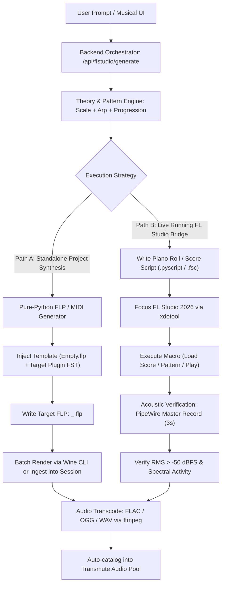

# FL Studio Prompt Automation Tab Spec (`flstudio-tab-spec.md`)

> **Status:** Draft / Specification Ready  
> **Audience:** Spec writers, builders, reviewers  
> **Target Document:** `docs/flstudio-tab-spec.md`  
> **Related Architecture:** `docs/STATUS.md`, `docs/airapper-spec.md`, `docs/cdp-integration-spec.md`, `app/audio_pipeline/metadata.py`, `app/shell.py`  
> **Live Host Context:** Arch Linux / wine-cachyos + WineASIO (`WINEPREFIX=/home/m/Wine/FLStudio`, FL Studio 2026 build `26.1.1.5547`), PipeWire Pro-Audio/WineASIO, active Xwayland window `FL Studio 2026`  

---

## 1. Overview & Objectives

The **FL Studio Automation Tab** (`flstudio`) introduces a dedicated workstation tab in the Transmute WebUI that transforms text prompts and musical constraints into automated FL Studio compositions and verified audio renders.

The user provides a natural language prompt or structured parameters specifying:
1. **Musical Root & Scale / Key**: e.g., $F^\sharp\text{ minor}$, $C\text{ Dorian}$, $B^\flat\text{ Major}$.
2. **Generative Musical Sequence**:
   - Scale run (ascending/descending reference notes).
   - Arpeggio pattern (descending, then ascending over target octave range).
   - Typical diatonic chord progression for that key (e.g., $i - VI - III - VII$, $I - V - vi - IV$, or jazz turnaround $ii^7 - V^7 - I^\text{maj7}$).
3. **Target Instrument Plugin**: Insertion/targeting of native FL generators (`FLEX`, `Sytrus`, `FL Keys`, `Harmless`, `Harmor`, `3x Osc`, `BooBass`, etc.) or user VST presets.
4. **Verified Live Playback & Acoustic Verification**: Triggering playback in the active FL Studio instance via Wine/X11 automation and pipe-monitoring audio capture to mathematically verify sound output (RMS $\ne -\infty$ dBFS, non-silent audio activity).
5. **Lossless Multi-Format Export**: Direct high-speed offline bounce or loopback capture rendered into FLAC, OGG, or WAV.
6. **Project Persistence**: Saving the resulting FL Studio Project (`.flp`) named programmatically as `<prompt_slug>_<key>_<bpm>.flp` directly into the user's FL Studio projects directory (`~/Documents/Image-Line/FL Studio/Projects/`).
7. **Transmute Pool Handoff**: Auto-stamping the rendered audio artifact into the Transmute Audio/Media Catalog and Video/Audio pool with musical metadata tags (`bpm`, `key`, `camelot`, `plugin`).

---

## 2. System Invariants & Architecture Compliance

| Invariant / Directive | Implementation Rule in FL Studio Tab |
|:---|:---|
| **Invariant 2: Subprocesses** | All external invocations (`wine`, `ffmpeg`, `xdotool`, `pw-record`, `sox`) execute strictly through `app.shell.run_command` with argv lists. **Never `shell=True`**. Never invoke subprocesses in `main.py`. |
| **Invariant 5: Dual Pools** | Rendered audio joins the Media / Audio Catalog and can be staged into pool items without mutating unrelated video pool states. |
| **Invariant 7: Vanilla Frontend** | Zero npm, React, Vue, or Tailwind. Pure vanilla HTML5, CSS3 Custom Properties, and ES6 modules (`js/tabs/flstudio.js`, `css/flstudio.css`). |
| **Invariant 10: HTTP Responses** | Endpoints return HTTP 200 with `{"ok": false, "error": "..."}` on errors, never uncaught 500s or 422 validation dumps. |
| **Invariant 11: `main.py`** | No `from __future__ import annotations` in `main.py` when registering the router. |
| **Invariant 12: WebUI Proof** | Automated Playwright acceptance suite (`junk/flstudio-prove.mjs`) clicking real UI controls against the live server with 0 console errors. Gate script `./check-gate.sh` must be clean. |
| **House Rule: Help-Strip** | Zero native `title="..."` tooltips anywhere on the tab. Every interactive control must carry `data-help-title` and `data-help-text` feeding the bottom help bar (`HelpStrip.audit()` must report zero hits). |
| **House Rule: Deprecations** | Adapt immediately to any deprecation warnings from ffmpeg or python libraries. |

---

## 3. Host Environment Discovery & Integration Modes

Inspection of the host system reveals the exact runtime footprint:
- **Wine Prefix**: `/home/m/Wine/FLStudio` (64-bit Wine prefix with WineASIO configured).
- **Executable**: `/home/m/Wine/FLStudio/drive_c/Program Files/Image-Line/FL Studio 2026/FL64.exe`.
- **User Directory**: `/home/m/Documents/Image-Line/FL Studio/` (contains `Projects/`, `Presets/`, `Settings/`).
- **Active Process**: `FL64.exe` (PID `494182`), Xwayland Window IDs `31457293` ("FL Studio 2026"), `31457309` ("Welcome to FL Studio").
- **Native Automation Hooks in FL Studio 2026**:
  1. **Piano Roll Scripts Engine (`flpianoroll`)**: Embedded Python interpreter executing `.pyscript` scripts directly manipulating `flp.Note`, `flp.score.addNote()`, `flp.score.clearNotes()`.
  2. **Binary FLP Project Format (`FLhd` / `FLdt`)**: Structured chunk binary file format defining channels, mixer assignments, plugin identifiers, and score data.
  3. **Headless / Wine Render Execution**: Wine CLI command execution `wine FL64.exe /R /E<format> ...` and GUI bridge via `xdotool` keyboard macros.
  4. **PipeWire Direct Capture**: `pw-record` and `ffmpeg -f pulse` tap WineASIO audio sinks to record master bus playback in real-time if headless background rendering is disabled.

### Dual-Path Operating Strategy

The spec defines two cooperating execution paths:



---

## 4. Musical Theory & Composition Engine

The prompt parser and musical generation engine decompose the user request into mathematical score structures.

### 4.1 Key, Scale & Chords Mapping

Using the canonical key normalization from `app/audio_pipeline/metadata.py`:
- **Pitch Classes**: $C=0, C^\sharp/D^\flat=1, D=2, \dots, B=11$.
- **Scale Intervals (Semitones)**:
  - Major (Ionian): `[0, 2, 4, 5, 7, 9, 11]`
  - Natural Minor (Aeolian): `[0, 2, 3, 5, 7, 8, 10]`
  - Harmonic Minor: `[0, 2, 3, 5, 7, 8, 11]`
  - Melodic Minor: `[0, 2, 3, 5, 7, 9, 11]`
  - Dorian: `[0, 2, 3, 5, 7, 9, 10]`
  - Mixolydian: `[0, 2, 4, 5, 7, 9, 10]`
  - Pentatonic Major / Minor.
- **Diatonic Progressions**:
  - Major default: $I - V - vi - IV$ (e.g., in $C$: $C - G - Am - F$) or $ii - V - I$.
  - Minor default: $i - VI - III - VII$ (e.g., in $Am$: $Am - F - C - G$) or $i - iv - V^7 - i$.
- **Arpeggiators**:
  - Triad / 7th Arpeggio pattern: Notes of chord $1 - 3 - 5 - (7) - 8$ descending then ascending.
  - Step size: $1/16$ or $1/8$ note divisions.
  - PPQ Basis: Standard FL Studio default $PPQ = 96$ ticks per quarter note ($1\text{ bar } = 4 \times 96 = 384\text{ ticks}$).

### 4.2 Score Assembly Timeline

Given root $K$, scale $S$, octave base $O=5$ (MIDI 60 for Middle C):
1. **Section 1: Scale Demonstration (Bar 1–2)**:
   - Run up through 1–2 octaves of scale notes ($1/8$ notes, length 48 ticks).
   - Run back down.
2. **Section 2: Arpeggios (Bar 3–4)**:
   - Descending arpeggio from top octave ($O+1$) down to tonic ($O-1$).
   - Ascending arpeggio back up.
3. **Section 3: Chord Progression (Bar 5–8)**:
   - 4-bar progression (1 bar per chord, 384 ticks per chord).
   - Voiced triads or 4-note extended chords with root in bass ($O-1$) and closed harmony in upper voice ($O$).

---

## 5. Instrument Plugin Directory & Presets

The system maps requested instrument names to factory generator paths in FL Studio:
- **Stock Generators**:
  - `FLEX` (`Plugins/Fruity/Generators/FLEX`)
  - `Sytrus` (`Plugins/Fruity/Generators/Sytrus`)
  - `FL Keys` (`Plugins/Fruity/Generators/FL Keys`)
  - `Harmless` (`Plugins/Fruity/Generators/Harmless`)
  - `Harmor` (`Plugins/Fruity/Generators/Harmor`)
  - `3x Osc` (`Plugins/Fruity/Generators/3x Osc`)
  - `BooBass` (`Plugins/Fruity/Generators/BooBass`)
  - `Minisynth` (`Plugins/Fruity/Generators/Minisynth`)
  - `Kepler` (`Plugins/Fruity/Generators/Kepler`)
  - `DirectWave` (`Plugins/Fruity/Generators/DirectWave`)
- **Plugin State Injection**:
  - Generator track templates located at:
    `/home/m/Wine/FLStudio/drive_c/Program Files/Image-Line/FL Studio 2026/Data/System/<Plugin>Track.fst` or `.fst` presets in `/home/m/Documents/Image-Line/FL Studio/Presets/Plugin database/Generators/`.

---

## 6. Verification & Audio Playback Detection

The tab must strictly verify that the generated composition **actually plays back sound** rather than silently creating an empty score or missing instrument routing.

### 6.1 Playback Trigger
1. Focus window: `xdotool search --class "FL64.exe" windowactivate --sync`.
2. Spacebar trigger: `xdotool key --window <window_id> space`.
3. Wait $200\text{ ms}$ for ASIO buffer pipeline to engage.

### 6.2 Acoustic Tap via PipeWire
1. Spawn 3-second audio tap using `pw-record` or ffmpeg pulse monitor:
   ```bash
   pw-record --target <sink_id> --format s16 --rate 44100 --channels 2 /tmp/fl_verify.wav
   ```
2. Stop playback: `xdotool key --window <window_id> space`.
3. Compute audio statistics via Python numpy/scipy:
   - Peak level (dBFS): $\text{peak} = 20 \log_{10}(\max |s|)$
   - RMS level (dBFS): $\text{rms} = 20 \log_{10}\sqrt{\frac{1}{N}\sum s_i^2}$
   - Spectral centroid / flatness to confirm harmonic content.
4. **Verification Rule**:
   - If $\text{rms} < -60\text{ dBFS}$ or $\text{peak} < -50\text{ dBFS}$: flag **`Acoustic Verification: FAILED (Silent / No Audio)`**.
   - If $\text{rms} \ge -60\text{ dBFS}$: mark **`Acoustic Verification: PASSED (Audible Signal Detected)`**.

---

## 7. Rendering & Export Engine

Once verified, the session renders the track into the requested audio formats:

1. **Format Targets**:
   - **FLAC**: Lossless 24-bit / 16-bit 44.1 kHz (`-c:a flac`).
   - **OGG**: Vorbis quality 8 (~256 kbps) (`-c:a libvorbis -q:a 8`).
   - **WAV**: PCM 24-bit / 16-bit 44.1 kHz (`-c:a pcm_s16le` / `pcm_s24le`).
2. **Naming Convention**:
   The FLP project and audio exports use the prompt-derived slug:
   ```
   ~/Documents/Image-Line/FL Studio/Projects/<prompt_slug>_<key>_<bpm>/<prompt_slug>_<key>_<bpm>.flp
   ~/Documents/Image-Line/FL Studio/Projects/<prompt_slug>_<key>_<bpm>/<prompt_slug>_<key>_<bpm>.<ext>
   ```
3. **Media Catalog Auto-Registration**:
   The output is ingested into `audio_catalog.db`:
   - `origin = "flstudio"`
   - `tempo = <bpm>`, `key_name = <key>`, `camelot = <camelot>`
   - `tags = ["flstudio", plugin_name, scale_name]`

---

## 8. Frontend Interface Layout (`flstudio.js` & `flstudio.css`)

The tab follows the bare-workspace card architecture of the AI Rapper and CDP tabs:

```
+----------------------------------------------------------------------------------------------------+
|  FL STUDIO PROMPT AUTOMATION                                          [Status: FL Studio 2026 ●]   |
+----------------------------------------------------------------------------------------------------+
|  [ Prompt Input & Natural Language Directives ]                                                   |
|  "Make an upbeat melody in F# minor with 3x Osc, ascending/descending arpeggio and emotional chords"|
|  [ Parse & Fill Controls ]                                                                        |
+----------------------------------+----------------------------------+------------------------------+
|  Musical Parameters              |  Generator & Plugin Selection    |  Playback & Export Settings  |
|  Root Key:       [ F#     ▼ ]    |  Instrument:   [ 3x Osc       ▼ ]|  Export Format: [ FLAC     ▼]|
|  Scale Type:     [ Minor  ▼ ]    |  Preset:       [ Default Saw  ▼ ]|  Target BPM:    [ 128     ]  |
|  Progression:    [ i-VI-III-VII ]|  Mixer Track:  [ 1            ]  |  Verify Audio:  [x] Yes      |
|  Include Scale:  [x] Asc/Desc    |  Octave Range: [ C4 to C6     ▼ ]|  Tail Cut:      [ 1.0 s   ]  |
|  Include Arp:    [x] Desc->Asc   |  Velocity:     [ 0.85         ]  |  FLP Project:   [x] Save     |
+----------------------------------+----------------------------------+------------------------------+
|  [ ACTION: Generate & Transmute to FL Studio ]      [ Test Audio Connection ]                      |
+----------------------------------------------------------------------------------------------------+
|  Session Console & Verification Log                                                                |
|  [10:45:01] Parsing musical constraints: F# Minor, 128 BPM, progression i - VI - III - VII         |
|  [10:45:02] Synthesized 96 score notes (Scale: 16 notes, Arp: 32 notes, Chords: 48 notes)         |
|  [10:45:03] Project saved: 'upbeat_fsharp_min_128.flp'                                             |
|  [10:45:04] Focusing FL Studio window (PID 494182)... Playing 3.0s test loop...                   |
|  [10:45:07] PipeWire master tap: Peak -6.2 dBFS, RMS -18.4 dBFS -> ACOUSTIC VERIFICATION PASSED ✓|
|  [10:45:08] Rendered FLAC: upbeat_fsharp_min_128.flac (2.4 MB) -> Added to Audio Pool ✦           |
+----------------------------------------------------------------------------------------------------+
|  Result Preview & Waveform: [ ▶ Play ] [ Waveform Scrub ] [ Open in Media Catalog 🔬 ]             |
+----------------------------------------------------------------------------------------------------+
```

---

## 9. FastAPI Route Contracts (`app/routes/flstudio.py`)

### 9.1 Status Check
- **`GET /api/flstudio/status`**
  - Answers:
    ```json
    {
      "ok": true,
      "fl_running": true,
      "pid": 494182,
      "window_title": "FL Studio 2026",
      "wine_prefix": "/home/m/Wine/FLStudio",
      "fl_binary": "/home/m/Wine/FLStudio/drive_c/Program Files/Image-Line/FL Studio 2026/FL64.exe",
      "project_dir": "/home/m/Documents/Image-Line/FL Studio/Projects",
      "plugins_available": ["FLEX", "Sytrus", "FL Keys", "3x Osc", "Harmless", "Harmor", "BooBass"]
    }
    ```

### 9.2 Prompt Decomposition
- **`POST /api/flstudio/parse_prompt`**
  - Body: `{"prompt": "string"}`
  - Answers: Extracted `root_key`, `scale_mode`, `bpm`, `instrument`, `progression`, `project_name`.

### 9.3 Generate, Play, Verify & Render
- **`POST /api/flstudio/execute`**
  - Body:
    ```json
    {
      "prompt": "upbeat melody in F# minor with 3x Osc",
      "project_name": "upbeat_fsharp_min",
      "root_key": "F#",
      "scale_mode": "minor",
      "bpm": 128,
      "progression": "i-VI-III-VII",
      "include_scale_run": true,
      "include_arpeggio": true,
      "plugin": "3x Osc",
      "export_format": "flac",
      "verify_playback": true
    }
    ```
  - Answers (HTTP 200 per Invariant 10):
    ```json
    {
      "ok": true,
      "flp_path": "/home/m/Documents/Image-Line/FL Studio/Projects/upbeat_fsharp_min/upbeat_fsharp_min.flp",
      "audio_path": "/home/m/Documents/Image-Line/FL Studio/Projects/upbeat_fsharp_min/upbeat_fsharp_min.flac",
      "format": "flac",
      "verification": {
        "verified": true,
        "peak_db": -6.2,
        "rms_db": -18.4,
        "duration_s": 3.0,
        "status": "passed"
      },
      "musical_meta": {
        "key": "F# minor",
        "short_key": "F#m",
        "camelot": "11A",
        "bpm": 128,
        "note_count": 96
      }
    }
    ```

---

## 10. Phased Implementation Roadmap & Test Verification

- **Phase 1: Musical Theory Core & Score Generator**:
  - Implement `app/flstudio/theory.py` for pitch-class math, scale runs, descending/ascending arpeggiator patterns, and chord voicings.
  - Implement MIDI / FSC / Score export testable in isolation.
- **Phase 2: Project & Template Assembly (`app/flstudio/project.py`)**:
  - Construct `.flp` project output combining base template (`Empty.flp`), channel generator assignment, and pattern score data.
- **Phase 3: Wine / X11 / PipeWire Acoustic Verification Bridge (`app/flstudio/bridge.py`)**:
  - Implement safe Xwayland window focus and spacebar toggle via `xdotool`.
  - Implement PipeWire master monitor capture and RMS/peak analysis.
- **Phase 4: Audio Transcode & Catalog Stamping**:
  - ffmpeg transcode to FLAC / OGG / WAV.
  - Media Catalog ingestion.
- **Phase 5: Frontend Desk Tab (`js/tabs/flstudio.js`, `css/flstudio.css`, `index.html`)**:
  - HelpStrip attributes, responsive bare-workspace layout, interactive waveform preview.
- **Phase 6: Automated Playwright & Pytest Verification**:
  - `tests/test_flstudio_theory.py`
  - `tests/test_flstudio_routes.py`
  - `junk/flstudio-prove.mjs` (full UI click-through, 0 console errors, HelpStrip clean).
