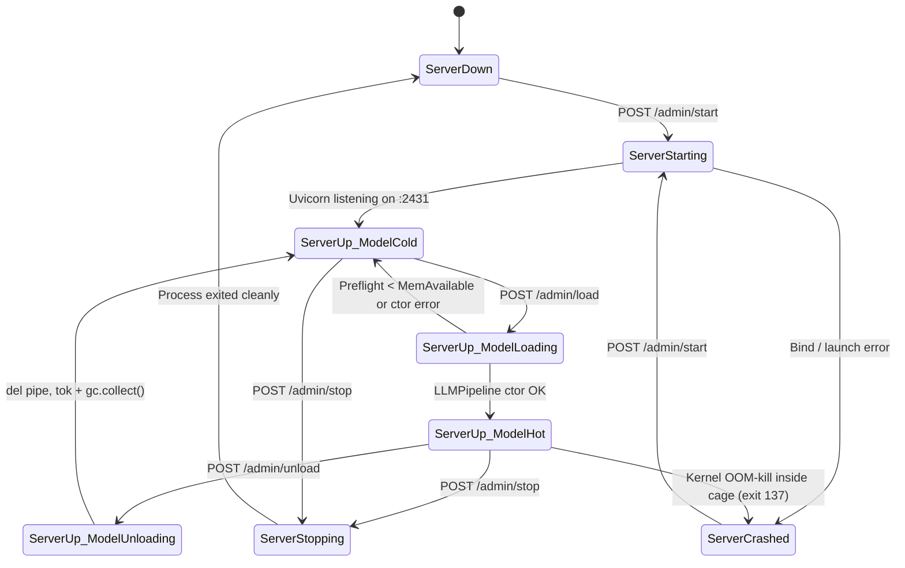

# OpenVINO Local LLM Server Tab (`openvino`) — Specification

> **Status:** Implemented; native Intel Playground OVMS runtime and context-budget correction verified 2026-10-23. Section 13 supersedes the original Python-only serving/default preflight assumptions.  
> **Hat:** Builder — existing server implementation plus model selection.  
> **Target workspace:** `/home/m/snc/cod/ffTransmuteWebui-wip/mtapi-project` (using `mtapi-project/.venv`)  
> **Reference prototype:** `/home/m/snc/cod/vinoapi` (`server.py`, `config.env`, `scripts/run-server.sh`, `scripts/smoke.py`)  
> **Related specs:** `docs/model-hot-status-spec.md` · `docs/ui-density-standard.md` · `docs/Hover-Help-Bar-Spec.md` · `docs/venv-deps-card-spec.md` · `docs/fast-check-gate-spec.md`

---

## 1. Overview & Problem Statement

We are integrating a controllable **OpenVINO GenAI Local LLM Server** directly into the `ffTransmute` WebUI as a dedicated **OpenVINO** tab (`data-tab="openvino"`). It hosts OpenVINO IR language models (starting with `Qwen3-8B-int4-ov` on the Intel Iris Xe iGPU) behind an OpenAI-compatible HTTP API (`/v1/chat/completions`, `/v1/models`, `/health`) managed by the WebUI process without relying on a background `systemd` `.service` unit file.

### 1.1 Why Cline Failed (`The run failed: Unprocessable Entity` / HTTP 422)

Testing `/home/m/snc/cod/vinoapi` with Cline resulted in `The run failed: Unprocessable Entity` after a few paragraphs of multi-turn conversation. Root-cause analysis identified five interacting architectural and configuration limits:

1. **Client Timeout vs. iGPU Prefill Latency (30,000 ms vs. 60–90 s):**
   - Cline's *Add Provider* UI hardcodes or defaults request timeout to `30000` ms (`30s`).
   - On this machine (`i5-1335U`, Intel Iris Xe iGPU, 16 GB unified memory), multi-turn prompts with Cline's large system prompt take **60–90 seconds in the prompt prefill phase** before the first token is emitted.
   - When no bytes or keep-alive frames arrive within 30s, the client or stream parser aborts mid-flight and surfaces a `422 Unprocessable Entity` / stream termination error.
   - **Fix:** Expose `timeout_ms` in the UI with a default of **`300000` ms (300 s / 5 minutes)**, advertise it in `/v1/models`, immediately flush the initial `role: "assistant"` SSE chunk before entering `_gen_lock`, and emit periodic SSE comment heartbeats (`: prefill-keepalive\n\n` every 5 seconds) while waiting for the first generated token.
2. **Missing `contextWindow` / `maxTokens` / `capabilities` in `/v1/models`:**
   - Cline's provider configuration UI has no manual inputs for `contextWindow` or `maxTokens`—it queries `GET /v1/models` to auto-discover model limits and capabilities.
   - `vinoapi/server.py` returned only `{"id": MODEL_ID, "object": "model", "created": 0, "owned_by": "openvino"}`. Without `context_length` / `contextWindow` / `max_tokens`, Cline falls back to restrictive or mismatched defaults and overflows context after a few replies.
   - **Fix:** Expose `context_window`, `max_tokens`, and `capabilities` (`streaming`, `tools`, `reasoning`, `vision`, `prompt_cache`) as editable settings in the WebUI and return all standard and extended fields in `GET /v1/models` and `GET /v1/models/{model_id}`.
3. **Strict Pydantic `Message.content: str` Validation in `vinoapi/server.py`:**
   - In `vinoapi/server.py`, `Message` declared `content: str` with no fallback.
   - In multi-turn conversations, Cline sends OpenAI content arrays (`[{"type": "text", "text": "..."}]`), `content: null` on assistant tool-call turns, and extra request keys (`stream_options`, `tools`, `tool_choice`, `reasoning_effort`, `stop`). FastAPI's Pydantic validation rejected these payloads with **HTTP 422 `Unprocessable Entity`** before `chat_completions()` even executed.
   - **Fix:** Accept `str | list[dict] | None` for `Message.content` (flattening text blocks and serializing tool calls/results into text when needed) and configure `model_config = ConfigDict(extra="allow")` on request schemas so `/v1/chat/completions` never 422s on extended OpenAI/Cline payloads.
4. **Hardcoded Port Collisions (`8000` vs. `29000` vs. `2431`):**
   - Standard tutorials hardcode port `8000` (which collides with other local services on this machine), while Intel AI Playground's `ovms` occupies `29000`.
   - **Fix:** Default port to **`2431`**, make it editable in the WebUI, and dynamically compute and display the live **Base URL** (`http://127.0.0.1:2431/v1`) and **Model Source URL** (`http://127.0.0.1:2431/v1/models`) with one-click copy buttons.
5. **Hardcoded Memory Cage &coupled Lifecycle:**
   - Previously, `MemoryMax`, `MemoryHigh`, `MemorySwapMax`, and `OOMScoreAdjust` were hardcoded in a `systemd` unit or CLI one-liner, and starting the server immediately loaded the 8B pipeline in `lifespan`.
   - **Fix:** Decouple **Server Up/Down** from **Model Hot/Cold**, and expose all memory cage parameters as editable WebUI fields passed to an abstracted launch-cage runner.

---

## 2. Core Two-Level State Machine

The system enforces a strict **two-level state model** so the HTTP endpoint (`http://127.0.0.1:2431/v1/models`) can stay online and discoverable by Cline with ~60 MB idle RSS even while the 6–8 GB iGPU model is unloaded (`Cold`).



### 2.1 Level 1 — Server Up / Down (Process Lifecycle)

Controls whether the dedicated OpenVINO `uvicorn` worker process is running and listening on `<host>:<port>` (default `127.0.0.1:2431`).

- **States:** `down` | `starting` | `up` | `stopping` | `crashed`
- **Status Telemetry:**
  - `server_state`: current Level-1 state string
  - `pid`: OS process ID of the caged `uvicorn` worker (`null` when down)
  - `uptime_s`: elapsed seconds since process start (`0` when down)
  - `host` / `port`: active bind address (e.g. `127.0.0.1:2431`)
  - `base_url`: `http://127.0.0.1:<port>/v1`
  - `model_source_url`: `http://127.0.0.1:<port>/v1/models`
  - `cage`: active caging metadata (`backend`, `scope_unit`, `memory_max`, `memory_high`, `memory_swap_max`, `oom_score_adjust`, `active_cgroup_path`)
  - `last_exit_code` & `last_exit_reason`: e.g., exit code `137` (`SIGKILL`) is flagged explicitly as `"Killed by kernel OOM killer inside memory cage (MemoryMax exceeded)"`.
- **Controls:**
  - **Start / Stop Server** toggle button (`POST /admin/start` / `POST /admin/stop`)
  - **Save & Apply (Restart)** button (`POST /admin/config` with `restart: true`)

### 2.2 Level 2 — Model Hot / Cold (Pipeline Residency Inside Running Server)

Controls whether `openvino_genai.LLMPipeline` is allocated in shared RAM / iGPU GEM memory inside the running `uvicorn` server.

- **States:** `cold` | `loading` | `hot` | `unloading` | `error`
- **Single-Hot-Model Invariant (Non-Negotiable):**
  - On a 16 GB unified-memory laptop (~15 GB usable shared RAM), **we NEVER keep `>1` model hot at once**.
  - If Model A is `hot` and `POST /admin/load` is called for Model B (or to reload Model A with new precision/device settings), the worker **must** first execute the full unload sequence (`_state.clear()`, release `LLMPipeline` and `Tokenizer` references, run `gc.collect()`) before checking `MemAvailable` preflight and constructing the new `LLMPipeline`.
- **Status Telemetry:**
  - `model_state`: current Level-2 state string
  - `loaded_model_id`: ID of the currently resident model (`null` when `cold`)
  - `loaded_model_path`: absolute filesystem path to the loaded IR folder (`null` when `cold`)
  - `device`: active OpenVINO device (`"GPU"`, `"CPU"`, `"NPU"`, `"AUTO"`)
  - `kv_cache_precision`: active KV precision (`"u4"`, `"u8"`, `"f16"`, `"auto"`)
  - `load_duration_s`: wall-clock seconds taken by the last `LLMPipeline` constructor
  - `process_rss_mb`: live `VmRSS` of the worker process from `/proc/<pid>/status`
  - `model_mem_used_mb`: `max(0, process_rss_mb - baseline_idle_rss_mb)`
  - `mem_available_mb`: live system `MemAvailable` from `/proc/meminfo`
  - `mem_total_mb`: system `MemTotal` from `/proc/meminfo`
  - `preflight_min_mb`: required `MemAvailable` threshold before load is permitted
  - `generating`: boolean indicating whether `_gen_lock` is currently held by an active inference request
- **Controls:**
  - **Load / Unload Model** toggle button (`POST /admin/load` / `POST /admin/unload`), enabled only when `server_state === "up"`.

---

## 3. Proven OpenVINO & Intel AI Playground Methods (Preserved from `vinoapi`)

The implementation **must** preserve the exact hardware-verified techniques from `/home/m/snc/cod/vinoapi/server.py` and `/home/m/snc/cod/vinoapi/scripts/smoke.py` that prevent unified-memory OOM crashes on the Intel Iris Xe iGPU:

### 3.1 Dynamic KV Cache Allocation (`SchedulerConfig`)
- **Rule:** Always construct `openvino_genai.LLMPipeline` with `scheduler_config=openvino_genai.SchedulerConfig()` (using default dynamic block allocation, equivalent to Intel AI Playground's `ovms --cache_size 0`).
- **Why:** Omitting `scheduler_config` falls back to the legacy static pipeline path, which pre-allocates the full `40960`-token KV cache at model load time and immediately OOM-kills a 16 GB unified-memory machine.

### 3.2 `u4` KV Cache Precision
- **Rule:** Pass `KV_CACHE_PRECISION=config.kv_cache_precision` (default `"u4"`) to `openvino_genai.LLMPipeline(...)`.
- **Why:** Matches Intel AI Playground's `ovms` configuration for `Qwen3-8B-int4-ov` on Iris Xe, cutting KV growth by 4× compared to `f16` during long multi-turn Cline sessions.

### 3.3 Compiled Model Blob & OpenCL Kernel Cache Reuse
- **Rule:** Before calling `openvino_genai.LLMPipeline(...)`, set:
  - `os.environ["GPU_PLUGIN_CACHE_DIR"] = config.cache_dir`
  - Pass `CACHE_DIR=config.cache_dir` (default `"/home/m/.cache/vinoapi/ov_cache"`) into `LLMPipeline(...)`.
- **Why:** Reusing the 11 GB of pre-compiled `.blob` and `.cl_cache` artifacts in `/home/m/.cache/vinoapi/ov_cache` allows `Qwen3-8B-int4-ov` to load in seconds with ~6–8 GB steady-state RSS. A cache miss triggers a from-scratch GPU OpenCL compile whose `i915` GEM allocation spike can exceed cgroup memory limits.

### 3.4 Preflight `MemAvailable` Guard & Orphaned `ovms` Detection
- **Rule:** Before constructing `LLMPipeline`, read `/proc/meminfo` (`MemAvailable`). If `avail_mb < config.preflight_min_mb` (default `8192` MB):
  - Refuse to load and return HTTP 200 + `{"ok": false, "error": "Not enough memory headroom (avail X MB < preflight Y MB)..."}`.
  - Check `/proc` (pure Python `/proc/<pid>/cmdline` scan, no `shell=True`) for running `ai-playground .../ovms` processes; if detected, append an explicit hint to the error message noting that Intel AI Playground's orphaned `ovms` backend is holding GPU memory hostage.

### 3.5 In-Process Self-RSS & Floor Watchdog (`smoke.py` Guards)
- Inside the worker process, run the lightweight daemon watchdog thread from `scripts/smoke.py` while a model is `loading` or `hot`:
  - **Self-RSS ceiling (`rss_cap_mb`, default `11500` MB):** If `/proc/self/status` `VmRSS` exceeds `rss_cap_mb` (indicating an uncached full-recompile runaway), log a clear diagnostic (`[watchdog] ABORT: self RSS > cap`) and exit with code `4` before the system freezes.
  - **Opt-in system floor (`watchdog_floor_enabled`, default `false`, `watchdog_min_mb=192`, `20` polls @ `0.25s`):** Disabled by default because low `MemAvailable` is normal steady state once an 8B model is resident on 16 GB RAM, while the cgroup cage (`MemoryMax=9G`, `OOMScoreAdjust=1000`) provides the hard kernel guarantee.

### 3.6 Chat Template & Streaming Queue (`_CollectStreamer` / `_AsyncStreamer`)
- Preserve `vinoapi/server.py`'s exact templating and streamer pattern:
  - Format messages via `tok.apply_chat_template(msgs, add_generation_prompt=True, **tpl_kwargs)` where `tpl_kwargs["extra_context"] = {"enable_thinking": think}` controls Qwen3's `<think>` reasoning block.
  - Set `cfg = pipe.get_generation_config()` and `cfg.apply_chat_template = False` (since the prompt is already templated).
  - Serialize GPU inference with `_gen_lock = threading.Lock()`.
  - Stream tokens from the generation thread into an `asyncio.Queue` via `loop.call_soon_threadsafe(queue.put_nowait, text)`.

---

## 4. Portability & Python Environment (`mtapi-project/.venv`)

### 4.1 First-Class Package Dependencies (Not Married to Intel Playground's Folder)
The project lives in its own module tree inside `mtapi-project` and executes under `mtapi-project/.venv/bin/python` (`AGENTS.md` Invariant 13). It must **not** require Intel AI Playground to be installed to build or run on a new machine.

`mtapi-project/requirements.txt` (and `pyproject.toml` if generated for standalone packaging) will declare:
```text
openvino>=2026.0
openvino-genai>=2026.0
openvino-tokenizers>=2026.0
fastapi>=0.115
uvicorn>=0.30
pydantic>=2.7
```
*(Note: `openvino 2026.3.1`, `fastapi 0.141.1`, and `uvicorn 0.52.4` are already present in `mtapi-project/.venv`; `openvino-genai` and `openvino-tokenizers` will be installed into `mtapi-project/.venv` via `uv pip install --python mtapi-project/.venv/bin/python` during the build phase).*

### 4.2 Optional Runtime Overlay Path (For Pre-Compiled `.blob` Cache Compatibility)
As documented in `vinoapi/README.md`, OpenVINO `.blob` caches are tied to the exact OpenVINO runtime build hash that compiled them (`ov: 2026.3.0-22271-6830129f539` in `~/.local/share/ai-playground/resources/OpenVINO/ovms` vs. PyPI `2026.3.1`).
- By default, the worker runs purely from `mtapi-project/.venv` (`runtime_overlay_path: ""`).
- As an optional advanced setting in the UI (`Runtime Overlay Path`), if set to a directory containing `lib/python` and `lib` (such as `/home/m/.local/share/ai-playground/resources/OpenVINO/ovms` on this laptop) and the path exists on disk, the launcher prepends `PYTHONPATH` and `LD_LIBRARY_PATH` when spawning the worker so existing 11 GB `.blob` caches hit immediately without recompilation.
- If the overlay path is blank or does not exist on a new machine, the launcher logs an info line and runs natively on `mtapi-project/.venv`.

---

## 5. Abstracted Launch Cage & Future Void Linux / No-Systemd Support

### 5.1 Why We Cage the Worker Process
On a unified-memory Linux laptop, an uncaged GPU LLM process that spikes memory can trigger a system-wide OOM lockup or kill the desktop session / parent `mtapi` WebUI. Wrapping ONLY the `uvicorn` LLM child process in a memory cage with `OOMScoreAdjust=1000` and `MemorySwapMax=0` guarantees **crash-not-global-OOM**: the kernel kills the LLM worker immediately when it hits `MemoryMax`, and the parent `mtapi` WebUI catches the child exit code (`137`) and displays a clean status banner.

### 5.2 Current Default Backend: `systemd-run --user --scope` (Transient Scope, NOT a Service Unit)
Unlike a `.service` unit file (which lives in `~/.config/systemd/user/`, runs behind `systemctl`, and hides logs/lifecycle from the WebUI), `--scope` runs the child process **synchronously as a direct child of the WebUI supervisor**, inheriting pipes (`stdout`/`stderr`) and signals (`SIGTERM`/`SIGKILL`) while placing the PID inside a transient cgroup v2 scope with the configured resource limits:

```text
systemd-run --user --scope \
  -p MemoryMax=9G \
  -p MemoryHigh=8G \
  -p MemorySwapMax=0 \
  -p OOMScoreAdjust=1000 \
  -- /home/m/snc/cod/ffTransmuteWebui-wip/mtapi-project/.venv/bin/python \
  -m uvicorn app.openvino_llm.worker:app --host 127.0.0.1 --port 2431
```

### 5.3 Launcher Abstraction Interface (Void Linux / No-Systemd Fallback Note)

> [!IMPORTANT]
> **Void Linux / No-Systemd Portability Requirement:** We are phasing out `systemd` dependency and need a clean fallback for Void Linux (`runit`) and other non-systemd hosts. All process launching MUST go through the `CageLauncher` abstraction in `app/openvino_llm/cage.py`—never hardcode `systemd-run` inside route handlers or supervisor logic.

```python
class CageConfig(BaseModel):
    backend: str = "auto"           # "auto" | "systemd_scope" | "cgroup_prlimit" | "none"
    memory_max: str = "9G"          # e.g. "9G", "10G", "9216M"
    memory_high: str = "8G"         # e.g. "8G", "8192M"
    memory_swap_max: str = "0"      # "0" disables swap thrashing for the LLM worker
    oom_score_adjust: int = 1000    # -1000..1000 (1000 = kill this worker first)
```

| Backend ID | Detection / Availability | How It Enforces the Cage |
|---|---|---|
| `systemd_scope` | `shutil.which("systemd-run")` present and `/run/user/<uid>/systemd` exists | Spawns via `systemd-run --user --scope -p MemoryMax=<memory_max> -p MemoryHigh=<memory_high> -p MemorySwapMax=<memory_swap_max> -p OOMScoreAdjust=<oom_score_adjust> -- <python_argv>` |
| `cgroup_prlimit` *(Void Linux / no-systemd fallback)* | Linux host without `systemd-run` (e.g. Void Linux / `runit`) | 1. Checks if `/sys/fs/cgroup` has a writable user-delegated cgroup v2 subtree; if writable, creates leaf cgroup `vinoapi-<pid>`, writes `memory.max`, `memory.high`, `memory.swap.max`, and moves child PID into `cgroup.procs`.<br>2. Wraps argv with `prlimit` (if `shutil.which("prlimit")`) and writes `oom_score_adjust` directly into `/proc/<pid>/oom_score_adj` immediately on child start (plus sets `resource.setrlimit(RLIMIT_AS, ...)` / self-RSS watchdog inside the worker). |
| `none` | Explicit user opt-out for debugging | Spawns `<python_argv>` directly; sets `/proc/self/oom_score_adj` best-effort and relies on the in-process `rss_cap_mb` watchdog. Renders an amber `UNCAGED` warning pill in the WebUI. |

**Invariant 2 Compliance:** Every launcher backend constructs a pure `list[str]` argv and spawns via `asyncio.create_subprocess_exec(*argv, stdout=PIPE, stderr=PIPE, env=child_env)`. `shell=True` and `os.system` are **never** used.

---

## 6. File & Module Structure (`mtapi-project`)

```text
docs/
  openvino-tab-spec.md                # Canonical spec (this document)
  spec.md                             # Alias copy in docs/ per prompt request
mtapi-project/
  data/
    openvino_llm/
      settings.json                   # Persisted UI config & models catalog
      config.env                      # Auto-exported env file for CLI parity
  app/
    openvino_llm/
      __init__.py
      config.py                       # Pydantic settings model, defaults, atomic load/save
      cage.py                         # CageLauncher protocol + SystemdScope / CgroupPrlimit / Uncaged backends
      supervisor.py                   # Level-1 process manager (start/stop/restart, log ringbuffer, proxy to worker)
      worker.py                       # Standalone FastAPI app run by uvicorn on :2431 (/v1/*, /health, /internal/*)
    routes/
      openvino_llm.py                 # WebUI routes: /admin/status, /admin/start, /admin/stop, /admin/load, /admin/unload, /admin/config
    static/
      js/
        tabs/
          openvino.js                 # Vanilla ES6 tab UI (2-level state cards, Cline settings, live log, test chat)
      css/
        openvino.css                  # Dense dark-theme layout adhering to docs/ui-density-standard.md
  tests/
    test_openvino_llm.py              # Unit + route + cage argv + /v1/models schema + Cline 422 regression tests
```

---

## 7. Configuration Schema & Defaults

All settings are persisted in `mtapi-project/data/openvino_llm/settings.json` (using atomic temp-file write + rename) and exposed in the WebUI.

### 7.1 Complete Settings Object (`data/openvino_llm/settings.json`)

```json
{
  "host": "127.0.0.1",
  "port": 2431,
  "api_key": "openvino-local",
  "enforce_api_key": false,
  "timeout_ms": 300000,
  "active_model_id": "Qwen3-8B-int4-ov",
  "models": [
    {
      "id": "Qwen3-8B-int4-ov",
      "model_path": "/home/m/.local/share/ai-playground/resources/models/LLM/openvino/OpenVINO---Qwen3-8B-int4-ov",
      "context_window": 40960,
      "max_tokens": 4096,
      "max_tokens_default": 1024,
      "enable_thinking_default": false,
      "temperature_default": 0.7,
      "top_p_default": 0.95,
      "capabilities": {
        "streaming": true,
        "tools": true,
        "reasoning": true,
        "vision": false,
        "prompt_cache": true
      }
    }
  ],
  "runtime": {
    "model_path": "/home/m/.local/share/ai-playground/resources/models/LLM/openvino/OpenVINO---Qwen3-8B-int4-ov",
    "cache_dir": "/home/m/.cache/vinoapi/ov_cache",
    "device": "GPU",
    "kv_cache_precision": "u4",
    "preflight_min_mb": 8192,
    "auto_load_on_start": false,
    "auto_load_on_request": true,
    "enable_sse_keepalive": true,
    "sse_keepalive_interval_s": 5,
    "runtime_overlay_path": "/home/m/.local/share/ai-playground/resources/OpenVINO/ovms"
  },
  "cage": {
    "backend": "auto",
    "memory_max": "9G",
    "memory_high": "8G",
    "memory_swap_max": "0",
    "oom_score_adjust": 1000,
    "rss_cap_mb": 11500,
    "watchdog_floor_enabled": false,
    "watchdog_min_mb": 192
  }
}
```

### 7.2 Configuration Field Reference

| Category | Field | Default | Purpose / Effect on Cline |
|---|---|---|---|
| **Endpoint** | `port` | `2431` | Avoids `8000` collisions and `29000` (`ovms`). Drives computed `Base URL` and `Model Source URL`. |
| **Endpoint** | `base_url` *(computed)* | `http://127.0.0.1:2431/v1` | Read-only display with **Copy** button; paste directly into Cline's *Base URL*. |
| **Endpoint** | `model_source_url` *(computed)* | `http://127.0.0.1:2431/v1/models` | Read-only display with **Copy** button; where Cline fetches model IDs and context limits. |
| **Endpoint** | `api_key` | `"openvino-local"` | Editable string with **Copy** button so Cline's required API Key input is never blank. |
| **Cline Limits** | `timeout_ms` | `300000` (300 s) | Replaces the broken `30000` ms default so 60–90 s iGPU prefill never times out. |
| **Cline Limits** | `context_window` | `40960` | Exported as `context_length`, `contextWindow`, and `max_model_len` in `/v1/models`. |
| **Cline Limits** | `max_tokens` | `4096` | Exported as `max_tokens` and `max_completion_tokens` in `/v1/models`; caps `max_new_tokens`. |
| **Cline Limits** | `capabilities` | `streaming: true`, `tools: true`, `reasoning: true`, `vision: false`, `prompt_cache: true` | Exported in `/v1/models` so Cline and OpenAI clients know which features the model supports. |
| **Models List** | `models[]` | `["Qwen3-8B-int4-ov"]` | Interactive chip list: type a model ID and press `Enter` to add; click chip to select active model; `×` to remove. |
| **Runtime** | `model_path` | `/home/m/.local/.../OpenVINO---Qwen3-8B-int4-ov` | Absolute path to the OpenVINO IR directory (`openvino_model.xml` / `.bin`). |
| **Runtime** | `cache_dir` | `/home/m/.cache/vinoapi/ov_cache` | Passed to `CACHE_DIR` and `GPU_PLUGIN_CACHE_DIR` so compiled blobs/kernels hit in seconds. |
| **Runtime** | `device` | `"GPU"` | OpenVINO target device (`GPU`, `CPU`, `NPU`, `AUTO`). |
| **Runtime** | `kv_cache_precision` | `"u4"` | Passed to `LLMPipeline(..., KV_CACHE_PRECISION=...)` (`u4`, `u8`, `f16`, `auto`). |
| **Runtime** | `preflight_min_mb` | `8192` | Minimum `/proc/meminfo` `MemAvailable` (in MB) required before `/admin/load` is allowed. |
| **Runtime** | `auto_load_on_request` | `true` | If `true` and a `/v1/chat/completions` call arrives while the server is `Up` but Model is `Cold`, automatically runs the guarded `load` step before generating. |
| **Memory Cage** | `memory_max` | `"9G"` | Hard cgroup memory ceiling (`-p MemoryMax=9G`). |
| **Memory Cage** | `memory_high` | `"8G"` | Soft throttle threshold (`-p MemoryHigh=8G`). |
| **Memory Cage** | `memory_swap_max` | `"0"` | Swap ceiling (`-p MemorySwapMax=0`) — prevents swap/zram thrashing on iGPU spikes. |
| **Memory Cage** | `oom_score_adjust` | `1000` | Kernel OOM killer priority (`-p OOMScoreAdjust=1000`) — guarantees worker dies before desktop. |

---

## 8. API Endpoints Specification

In accordance with **`AGENTS.md` Invariant 10**, all `/admin/*` and `/api/openvino/*` endpoints read request bodies safely and return **HTTP 200 with `{"ok": true, ...}` or `{"ok": false, "error": "..."}`** on operational or validation failures—never unhandled HTTP 422/500 exceptions.

### 8.1 Admin & Lifecycle Endpoints (Mounted on `mtapi` and proxied/synced with Worker)

The WebUI registers these routes in `app/routes/openvino_llm.py` at `/admin/*` (with `/api/openvino/admin/*` aliases for namespace consistency):

#### 1. `GET /admin/status`
Returns the combined 2-level state (`server` + `model`), live system memory telemetry, active configuration, and the tail of the worker log ringbuffer.

```json
{
  "ok": true,
  "server": {
    "state": "up",
    "running": true,
    "pid": 48291,
    "uptime_s": 142.6,
    "host": "127.0.0.1",
    "port": 2431,
    "base_url": "http://127.0.0.1:2431/v1",
    "model_source_url": "http://127.0.0.1:2431/v1/models",
    "cage": {
      "backend": "systemd_scope",
      "memory_max": "9G",
      "memory_high": "8G",
      "memory_swap_max": "0",
      "oom_score_adjust": 1000
    },
    "last_exit_code": null,
    "last_error": null
  },
  "model": {
    "state": "hot",
    "hot": true,
    "loaded_model_id": "Qwen3-8B-int4-ov",
    "loaded_model_path": "/home/m/.local/share/ai-playground/resources/models/LLM/openvino/OpenVINO---Qwen3-8B-int4-ov",
    "device": "GPU",
    "kv_cache_precision": "u4",
    "load_duration_s": 4.2,
    "generating": false,
    "process_rss_mb": 6840,
    "model_mem_used_mb": 6772,
    "mem_available_mb": 7412,
    "mem_total_mb": 15680,
    "preflight_min_mb": 8192
  },
  "config": { "...full settings.json object..." },
  "logs": [
    "2026-10-23 13:20:01 [supervisor] Launching caged uvicorn on 127.0.0.1:2431 (systemd_scope: MemoryMax=9G, MemoryHigh=8G, MemorySwapMax=0, OOMScoreAdjust=1000)",
    "2026-10-23 13:20:02 [vinoapi] Worker online (Model Cold, rss=68MB)",
    "2026-10-23 13:20:10 [vinoapi] MemAvailable before load: 11240MB (preflight 8192MB)",
    "2026-10-23 13:20:14 [vinoapi] pipeline loaded in 4.2s (model=Qwen3-8B-int4-ov, device=GPU, kv=u4)"
  ]
}
```

#### 2. `POST /admin/start`
Starts the caged `uvicorn` worker process on the configured `host:port`.
- **Optional JSON body:** `{"auto_load": false}` (overrides `runtime.auto_load_on_start` for this start).
- **Behavior:**
  1. If already `up`, returns `{"ok": true, "already_running": true, ...}` with current status.
  2. Checks if `<host>:<port>` is already bound by an external process; if occupied by a non-managed process, returns `{"ok": false, "error": "Port 2431 is already in use by another process"}`.
  3. Builds the caged argv via `CageLauncher` (`systemd-run --user --scope ...`) and spawns the worker in **Model Cold** state.
  4. Polls `GET http://127.0.0.1:<port>/health` (up to 10s, 200ms interval) until the worker answers.
  5. If `auto_load` is enabled, triggers `/admin/load`.
  6. Returns the full `/admin/status` payload with `"ok": true`.

#### 3. `POST /admin/stop`
Stops the running `uvicorn` worker process cleanly.
- **Behavior:**
  1. If already `down`, returns `{"ok": true, "already_stopped": true, ...}`.
  2. If a model is `hot`, calls `/internal/unload` (best-effort, 2s timeout) so OpenVINO releases GPU buffers cleanly.
  3. Sends `SIGTERM` to the worker process, waits up to 5 seconds, and sends `SIGKILL` if still alive.
  4. Clears `model_hot` residency in `mtapi` and returns the updated `/admin/status` payload (`server.state = "down"`, `model.state = "cold"`).

#### 4. `POST /admin/load`
Loads a single model pipeline into RAM/VRAM inside the running server (`Model Cold` → `Model Hot`).
- **Optional JSON body:**
  ```json
  {
    "model_id": "Qwen3-8B-int4-ov",
    "model_path": "/home/m/.local/share/ai-playground/resources/models/LLM/openvino/OpenVINO---Qwen3-8B-int4-ov",
    "device": "GPU",
    "kv_cache_precision": "u4"
  }
  ```
  *(If omitted, uses `active_model_id` and its configured `model_path`, `device`, and `kv_cache_precision`.)*
- **Behavior:**
  1. If `server.state != "up"`, returns `{"ok": false, "error": "Server is Down — start the server first before loading a model."}`.
  2. **Single-Hot-Model Guard:** If any model is already `hot` in the worker, unloads it first (`del pipe, tok; gc.collect()`) so `>1` model is never resident simultaneously.
  3. Verifies `model_path` exists and contains `openvino_model.xml`.
  4. Checks `/proc/meminfo` `MemAvailable >= preflight_min_mb`. If insufficient, returns `{"ok": false, "error": "Not enough memory headroom (MemAvailable X MB < preflight Y MB)..."}` and stays `cold`.
  5. Marks `app/model_hot.py` as `loading` for tool `openvino`, constructs `openvino_genai.LLMPipeline(model_path, device, scheduler_config=openvino_genai.SchedulerConfig(), CACHE_DIR=cache_dir, KV_CACHE_PRECISION=kv_cache_precision)`, caches `pipe.get_tokenizer()`, and transitions to `hot` (updating `app/model_hot.py` to `loaded`).
  6. Returns the updated `/admin/status` payload.

#### 5. `POST /admin/unload`
Unloads the resident `LLMPipeline` from RAM/VRAM while keeping the `uvicorn` HTTP server **Up** (`Model Hot` → `Model Cold`).
- **Behavior:**
  1. If `server.state != "up"`, returns `{"ok": true, "already_cold": true, ...}`.
  2. Waits for `_gen_lock` (or aborts if idle), deletes `pipe` and `tok` from `_state`, invokes `gc.collect()` (and `malloc_trim(0)` via `ctypes` `libc.so.6` on Linux so freed heap pages return to the OS immediately), and updates `app/model_hot.py`.
  3. Returns the updated `/admin/status` payload showing the dropped `process_rss_mb` and recovered `mem_available_mb`.

#### 6. `POST /admin/config`
Saves updated configuration settings and optionally restarts the server to apply them.
- **JSON body:** Partial or full settings update + `"restart": true | false` (default `true` when `server.state == "up"`).
- **Behavior:**
  1. Validates port (`1024..65535`), positive integers for `timeout_ms`, `context_window`, `max_tokens`, `preflight_min_mb`, and non-empty `models` list (returning HTTP 200 + `{"ok": false, "error": "..."}` on invalid input).
  2. Atomically writes `data/openvino_llm/settings.json` and `data/openvino_llm/config.env`.
  3. If the server is `up` and `restart` is `true`:
     - Records whether a model was `hot` prior to restart.
     - Executes `stop()` → `start()` with the new port, cage settings, and runtime parameters.
     - If a model was previously `hot` (or `auto_load_on_start` is true), reloads the active model.
  4. Returns the updated `/admin/status` payload.

---

### 8.2 OpenAI-Compatible Worker Endpoints (Served on `http://127.0.0.1:<port>`)

#### 1. `GET /v1/models` and `GET /v1/models/{model_id}`
Returns the OpenAI model list enriched with every context-length, token-limit, timeout, and capability key recognized by **Cline**, **LiteLLM**, **OpenRouter**, **vLLM**, and **OpenAI-compatible clients**.

```json
{
  "object": "list",
  "data": [
    {
      "id": "Qwen3-8B-int4-ov",
      "object": "model",
      "created": 1761220000,
      "owned_by": "openvino",
      "root": "Qwen3-8B-int4-ov",
      "parent": null,
      "context_length": 40960,
      "contextWindow": 40960,
      "max_model_len": 40960,
      "max_context_length": 40960,
      "max_tokens": 4096,
      "maxTokens": 4096,
      "max_completion_tokens": 4096,
      "timeout": 300000,
      "timeout_ms": 300000,
      "capabilities": {
        "streaming": true,
        "tools": true,
        "reasoning": true,
        "vision": false,
        "prompt_cache": true,
        "function_calling": true
      },
      "model_info": {
        "context_window": 40960,
        "max_tokens": 4096,
        "supports_streaming": true,
        "supports_tools": true,
        "supports_reasoning": true,
        "supports_vision": false,
        "supports_prompt_cache": true,
        "timeout_ms": 300000,
        "device": "GPU",
        "kv_cache_precision": "u4",
        "hot": true
      }
    }
  ]
}
```
> **Why all aliases (`context_length`, `contextWindow`, `max_model_len`, `max_tokens`, `maxTokens`, `max_completion_tokens`, `capabilities`, `model_info`) are included:** Different versions of Cline and OpenAI provider adapters inspect different keys (`context_length` for OpenRouter/LM Studio style, `contextWindow` / `maxTokens` for Cline internal `ModelInfo`, `max_model_len` for vLLM). Providing all of them in a single canonical payload guarantees Cline picks up the exact limits configured in the WebUI without code changes in Cline.

#### 2. `POST /v1/chat/completions`
OpenAI-compatible chat completion endpoint supporting both `stream: true` (SSE) and `stream: false` (JSON), hardened against Cline's multi-turn failure modes:

- **Lenient Request Parsing (Zero 422s on Cline Payloads):**
  - Accepts extra OpenAI fields (`stream_options`, `tools`, `tool_choice`, `parallel_tool_calls`, `reasoning_effort`, `stop`, `presence_penalty`, `frequency_penalty`, `user`, etc.) without raising `422 Unprocessable Entity`.
  - Normalizes `message.content`:
    - If `str`: used directly.
    - If `list` (OpenAI content blocks, e.g. `[{"type": "text", "text": "..."}]`): extracts and joins all `"text"` blocks in order.
    - If `None` (e.g., an assistant turn containing `tool_calls`): converts `tool_calls` into a structured text representation so `tok.apply_chat_template()` never crashes on `None`.
- **Cold-Model Handling:**
  - If `model.state == "cold"` when a request arrives:
    - If `runtime.auto_load_on_request` is `true` (default), automatically runs the preflight-guarded `load_pipeline()` before inference.
    - If `runtime.auto_load_on_request` is `false`, returns a clean OpenAI error object (`{"error": {"message": "Model is currently Cold (unloaded). Click 'Load Model' in the OpenVINO tab or enable Auto-Load on Request.", "type": "server_error", "code": "model_cold"}}`).
- **Prefill Keep-Alive & Timeout Resilience (`stream: true`):**
  - Immediately yields the opening SSE chunk (`{"choices": [{"index": 0, "delta": {"role": "assistant"}, "finish_reason": null}]}`) **before** waiting on `_gen_lock` or `pipe.generate()`, so the HTTP client receives headers and first bytes within milliseconds.
  - While `pipe.generate()` is executing the 60–90 s iGPU prefill and `queue.get()` is waiting for the first token, awaits with a `5.0s` timeout and yields a standard SSE comment heartbeat (`: prefill-keepalive\n\n`) whenever `enable_sse_keepalive` is true. SSE comments are ignored by OpenAI/Cline SSE parsers per the WHATWG EventStream spec, but keep the TCP socket and client read-timeout timer alive across the entire 60–90 s prefill!
  - If `stream_options.include_usage` is requested by Cline, emits the final `usage` chunk (`prompt_tokens`, `completion_tokens`, `total_tokens`) before `data: [DONE]\n\n`.

#### 3. `GET /health`
Returns fast worker liveness and model state:
```json
{
  "status": "ok",
  "server_state": "up",
  "model_state": "hot",
  "model": "Qwen3-8B-int4-ov",
  "device": "GPU",
  "kv_cache_precision": "u4",
  "process_rss_mb": 6840,
  "mem_available_mb": 7412
}
```

---

## 9. WebUI Tab Design (`app/static/js/tabs/openvino.js` & `css/openvino.css`)

### 9.1 Navigation & Workspace Integration
- **Sidebar Navigation (`index.html`):** Added under the **Neural FX** section right next to `Agent` (`data-tab="openvino"`, label `OpenVINO`, chip/CPU icon, full `data-help-title` and `data-help-text`).
- **Bare Workspace Mode:** Added to `HIDE_TABS` (`js/ui/input-preview.js`), `noGlobalInputs` (`app.js`), and body class `openvino-tab-active` so the global video preview pane and input bar are hidden and the OpenVINO control deck uses 100% of the workspace width and height with zero nested vertical scroll frames (`docs/ui-density-standard.md`).
- **Header GitHub Integration (`js/ui/tab-github-repos.js`):** Registers `openvino` with links to `openvinotoolkit/openvino.genai` and `openvinotoolkit/openvino`.
- **Global Model Residency (`app/model_hot.py` & `app/model_inventory.py`):** Registers `openvino` so the global model-hot dot turns **Yellow** during `/admin/load`, **Green** when `hot` on the OpenVINO tab, **Red** when `hot` while visiting another tab, and **Orange** when `cold`.

### 9.2 Layout Wireframe (2-Level State Deck + Editable Config Cards)

```text
┌─ OpenVINO · Local GenAI Server & Cline Controller ──────────────────────────────────────────────────┐
│ ┌─ LEVEL 1: SERVER PROCESS (Uvicorn) ─────────────┐ ┌─ LEVEL 2: MODEL PIPELINE (RAM / iGPU VRAM) ─┐ │
│ │ ● UP   PID: 48291 · Uptime: 02m 22s · Port 2431 │ │ ● HOT   Qwen3-8B-int4-ov (GPU · KV u4)      │ │
│ │ Cage: systemd_scope (Max 9G · High 8G · Swap 0) │ │ RSS: 6,840 MB (+6,772 MB) · Avail: 7,412 MB │ │
│ │ [ ■ Stop Server ]  [ ↻ Save & Restart Server ]  │ │ [ ▼ Unload Model ]  (Max 1 Hot on 15GB RAM) │ │
│ └─────────────────────────────────────────────────┘ └─────────────────────────────────────────────┘ │
│                                                                                                     │
│ ┌─ 1. Connection & Cline Endpoint ────────────────┐ ┌─ 2. Cline Model Limits & Capabilities ──────┐ │
│ │ Host [127.0.0.1]  Port [2431 ]  API Key [•••••] │ │ Timeout (ms) [300000 ]  Ctx Window [40960 ] │ │
│ │ Base URL:         http://127.0.0.1:2431/v1 [Cp] │ │ Max Tokens   [4096   ]  Def Tokens [1024  ] │ │
│ │ Model Source URL: .../2431/v1/models       [Cp] │ │ Capabilities: [✓] Streaming  [✓] Tools      │ │
│ │ Models: [Qwen3-8B-int4-ov ★ ×] [+ Type ID ⏎  ] │ │ [✓] Reasoning [ ] Vision     [✓] PromptCache│ │
│ └─────────────────────────────────────────────────┘ │ [ ] Enable Qwen3 <think> by default         │ │
│                                                     └─────────────────────────────────────────────┘ │
│ ┌─ 3. OpenVINO Runtime & Paths ───────────────────┐ ┌─ 4. Memory Cage & Watchdog Guards ──────────┐ │
│ │ Model Path [/home/m/.local/.../Qwen3-8B..][Brw] │ │ Cage Backend [auto (systemd_scope) ▼]       │ │
│ │ Cache Dir  [/home/m/.cache/vinoapi/ov_cac][Brw] │ │ MemoryMax [9G  ]  MemoryHigh     [8G   ]    │ │
│ │ Device [GPU ▼]  KV Cache [u4 ▼]  Preflight[8192]│ │ SwapMax   [0   ]  OOMScoreAdjust [1000 ]    │ │
│ │ [✓] Auto-load on chat request  [✓] SSE Keepalive│ │ RSS Cap   [11500] [ ] Floor Watchdog (192M) │ │
│ │ Overlay    [/home/m/.local/.../ovms      ][Brw] │ │ Note: Void Linux / prlimit fallback ready   │ │
│ └─────────────────────────────────────────────────┘ └─────────────────────────────────────────────┘ │
│                                                                                                     │
│ ┌─ 5. Quick Smoke Test & Live Server Log ─────────────────────────────────────────────────────────┐ │
│ │ Prompt [Say hello in one sentence.                          ] [▶ Send Test]  Tok/s: 18.4 (1.2s) │ │
│ │ Reply: Hello! How can I help you today?                                                         │ │
│ │ 2026-10-23 13:20:02 [vinoapi] Worker online (Model Cold, rss=68MB)                              │ │
│ │ 2026-10-23 13:20:14 [vinoapi] pipeline loaded in 4.2s (model=Qwen3-8B-int4-ov, device=GPU)      │ │
│ └─────────────────────────────────────────────────────────────────────────────────────────────────┘ │
└─────────────────────────────────────────────────────────────────────────────────────────────────────┘
```

### 9.3 Interactive UI Behaviors
1. **Live Computed URLs:** Typing in the `Port` or `Host` input updates the displayed **Base URL** (`http://<host>:<port>/v1`) and **Model Source URL** (`http://<host>:<port>/v1/models`) in real time; clicking **Copy** writes the exact string to `navigator.clipboard` and flashes `"Copied!"`.
2. **Models Chip Input (`type ID + Enter`):**
   - Typing a model ID in `#ovModelAddInput` and pressing `Enter` adds it to `models[]` and renders a chip.
   - Clicking a model chip marks it as the active model (`★`) and loads its per-model settings into the form.
   - Clicking `×` on a chip removes it from `models[]` (minimum 1 model kept).
3. **Save / Apply Restarts Server:**
   - Clicking **Save & Apply** (or **Save & Restart Server**) sends `POST /admin/config` with `restart: true`. If the server is currently `Up`, it restarts with the new port, cage settings, and model metadata; if `Down`, it saves the config immediately so the next **Start Server** uses the new values.
4. **Polling & HelpStrip Compliance:**
   - Polls `GET /admin/status` every `3000 ms` while the `openvino` tab is active (and immediately after any Start/Stop/Load/Unload/Save click).
   - Every control carries `data-help-title` and `data-help-text` for the bottom HelpStrip; zero native `title=` attributes (`HelpStrip.audit() === 0`).

---

## 10. Rules, Best Practices & Failure Modes

1. **Never Keep `>1` Model Hot on 15 GB Shared RAM:**
   - The worker holds at most one `LLMPipeline` instance in `_state["pipe"]`. Any load request unloads the existing pipeline and triggers `gc.collect()` + `malloc_trim(0)` before checking `MemAvailable` preflight.
2. **Never Pre-Allocate Full 40,960-Token KV Cache:**
   - `scheduler_config=openvino_genai.SchedulerConfig()` is mandatory on every `LLMPipeline` construction.
3. **Always Preserve the Compiled Cache (`CACHE_DIR` + `GPU_PLUGIN_CACHE_DIR`):**
   - Never clear or bypass `/home/m/.cache/vinoapi/ov_cache` automatically; warn in the UI if the selected `cache_dir` does not exist or is empty (as an empty cache triggers a multi-gigabyte OpenCL compile).
4. **Preflight Memory Gate (`MemAvailable >= preflight_min_mb`):**
   - Refuse `/admin/load` cleanly with HTTP 200 + `{"ok": false, "error": "..."}` when `MemAvailable` is below threshold, rather than gambling with system stability.
5. **Detect & Warn on Orphaned Intel AI Playground `ovms`:**
   - Intel AI Playground often leaves orphaned `ovms` processes running on port `29000` after its UI closes, holding 6–8 GB of GPU GEM memory in zram. `/admin/status` and failed `/admin/load` checks inspect `/proc` for `ai-playground/resources/OpenVINO/ovms` and surface a warning banner if found.
6. **Subprocess & Route Invariants (`AGENTS.md` #2, #10, #11, #12, #13):**
   - All subprocesses launch via `asyncio.create_subprocess_exec` with argv lists (`shell=True` is forbidden; no `import subprocess` in `app/main.py`).
   - All `/admin/*` failures return HTTP 200 + `{"ok": false, "error": "..."}`.
   - `app/main.py` never imports `from __future__ import annotations`.
   - Gate check (`./check-gate.sh` 5/5) + pytest (`mtapi-project/.venv/bin/python -m pytest`) + real Playwright clicks on the live WebUI are required before claiming DONE in the build phase.

---

## 11. Verification Plan (For Builder Phase After Spec Approval)

1. **Fast Check Gate:** `./check-gate.sh` passes 5/5 (JS ESM syntax, import resolution, HTML tag balance, Python syntax).
2. **Unit & Contract Tests (`mtapi-project/tests/test_openvino_llm.py`):**
   - `CageLauncher` argv generation for `systemd_scope` (`systemd-run --user --scope -p MemoryMax=9G -p MemoryHigh=8G -p MemorySwapMax=0 -p OOMScoreAdjust=1000 -- ...`), `cgroup_prlimit` (Void Linux fallback), and `none`.
   - `/v1/models` response shape asserting `context_length`, `contextWindow`, `max_tokens`, `timeout_ms: 300000`, and `capabilities` (`streaming`, `tools`, `reasoning`, `vision`, `prompt_cache`) reflect live config edits.
   - `/v1/chat/completions` regression test for Cline multi-turn payloads (array-of-blocks `content`, `content: null` with `tool_calls`, unknown OpenAI fields, SSE `prefill-keepalive` comment emission) confirming zero HTTP 422 responses.
   - 2-level state transitions (`down` → `up/cold` → `up/hot` → `up/cold` → `down`) and single-hot-model replacement guard.
   - Preflight `MemAvailable` refusal returning HTTP 200 + `{"ok": false}`.
3. **Playwright Live Browser Verification (`mtapi-project/junk/openvino-tab-prove.mjs`):**
   - Navigate to the **OpenVINO** tab, verify 0 console/page errors, `HelpStrip.audit() === 0`, and `scrollWidth === clientWidth` at `1560px` and `800px`.
   - Verify editable controls: change Port (`2431`), verify computed Base URL (`http://127.0.0.1:2431/v1`) and Model Source URL (`http://127.0.0.1:2431/v1/models`), add a model ID via `Enter`, toggle capabilities, edit Memory Cage settings, click **Save & Apply**, click **Start Server** (`Server Up / Model Cold`), verify `GET /v1/models` returns the updated `context_length` and `timeout_ms`, click **Load Model** (`Model Hot` or preflight guard verification), and capture proof screenshot in `mtapi-project/junk/openvino_tab_proof.png`.

## 12. Intel AI Playground model chooser (as built)

- Level 2 **Model** is a labeled native select. Clicking a configured model chip also opens the full chooser. Installed and download-needed text models are grouped separately; all 21 OpenVINO rows from the installed Playground catalog are represented. GGUF and embedding rows belong to other backends and are excluded. With the default native Playground OVMS engine, all 21 entries are selectable, including vision models. Only the optional legacy Python GenAI engine disables the eight vision entries.
- `GET /api/openvino/models` reads `~/.local/share/ai-playground/resources/models.json` and resolves `openvinoLLM` in its adjacent `model_config.json`, including Playground's application-relative paths. `MTAPI_AI_PLAYGROUND_RESOURCES` overrides the resources directory. A bundled snapshot supplies the same list when the installed catalog is missing/unreadable; the UI identifies this fallback.
- Choosing a new model creates its own settings entry with its real `OpenVINO---<model>` directory, Playground tool/reasoning metadata, and context limits. Existing per-model edits survive switching. Native capacity is shown separately; initial context is capped at 40,960 tokens rather than automatically advertising the largest native window. Users can lower the context budget. Selection is a draft until **Save & Apply**, which uses the existing restart/unload-before-load path. The Resident readout continues to report the model actually in memory.
- Missing models expose **Download**. `POST /api/openvino/models/download` accepts catalog IDs only, serializes downloads, reuses Playground storage, and downloads Hugging Face repository files without loading weights into RAM. The existing job-control tracker reports each file; the selector shows completion/errors and refreshes readiness. Required nonempty model/config/tokenizer files determine download readiness. No deprecated Hugging Face resume/symlink flags are used. Saving a catalog model without its weights is blocked before restarting the server.
- All controls include HelpStrip metadata; chooser works by keyboard, has visible focus and associated help, and fits 1560/800/480px layouts. Downloads are asynchronous and remain separate from model residency and the memory cage.
- Verification: gate 5/5; 30 targeted catalog/server/invariant tests; 20 real Playwright checks in `mtapi-project/junk/openvino-model-picker-prove.mjs` on an isolated WebUI, with fixture model files for persistence tests (never loaded). Production smoke uses the installed catalog and retains the original Qwen3-8B selection. Download network/weight transfer success and failure are tested with substituted Hugging Face calls; no additional model weights were downloaded for verification.

Initial chooser verification (before the native engine correction in §13): `junk/openvino-model-picker-live-prove.mjs` passed 11/11 against the real Playground catalog, including actual native picker clicks/keyboard selection and the separate Resident readout. Live app is reloaded and original Qwen3-8B selection retained; rewarming was refused at 7,453 MB available versus the unchanged 8,192 MB minimum, leaving Server Up / Model Cold. No memory safeguards were lowered. Production screenshot: `mtapi-project/junk/openvino-model-picker-live-proof.png`.

## 13. Native Intel Playground serving and model-independent memory admission

**Problem:** the prototype's global `preflight_min_mb=8192` was applied to every fresh model load. It was unrelated to the selected weights or context: TinyLlama's ~602 MiB model was rejected at 7,903 MB available. A resident 8B model could keep running because this check was only performed at load time. Reusing the catalog alone did not reproduce Playground's serving behavior.

**Observed installed implementation:** `/usr/lib/ai-playground/resources/app.asar`, `dist/main/main.js`, functions `startOvmsLlmServer`, `resolveToolParser`, and `buildOvmsEnv`. Extracted module SHA256 and bounded function text are in `mtapi-project/junk/playground-settings-source/observed-llm-profile.txt`; the installed executable's help is `ovms-help.txt` in the same folder. A broad REA graph analysis was cancelled; conclusions are limited to the extracted functions, installed CLI, and actual runtime verification, not a whole-application audit.

### Serving profile

- Default `runtime.engine=playground` launches the actual installed `runtime_overlay_path/bin/ovms`, not a second Python implementation of chat generation. The existing caged FastAPI worker stays available cold on port 2431 and forwards native chat requests to a loopback-only internal OVMS port. `genai` explicitly selects the legacy `LLMPipeline` implementation.
- Copied launch settings: REST bind `127.0.0.1`; 4 REST workers; selected local source model and repository; target device; task `text_generation`; model-specific `toolParser` from Playground metadata with `hermes3` fallback; reasoning parser `qwen3`; compiled cache directory; optional selected KV precision; NPU-only `max_prompt_len` from the selected context. Public model aliases, configured cache location, memory cage, and the cold facade remain WebUI integrations.
- Installed OVMS defaults, exposed as controls: `cache_size=0` (dynamic allocation), `max_num_seqs=256`, prefix caching true, dynamic split/fuse true. Batch-token zero leaves the native default. No invented cache reservation or GPU context preallocation is added. Existing device/KV/cache and per-model generation preferences remain editable.
- Native environment matches Playground isolation: strip inherited Python/venv environment, remove foreign venv executables from PATH, use bundled OVMS libraries/Python modules and the installed managed CPython 3.12 runtime. Existing model files are reused. No dependency/model reinstall is needed on this machine.

### Memory policy and lifecycle

- Default `runtime.preflight_policy=playground` has **no arbitrary fixed MemAvailable admission threshold**. Existing configs inherit this new default; their stored 8192 MB value is inactive. `fixed` is an explicit custom policy retaining the old configurable threshold. The UI disables its numeric control when inactive and labels the active policy in telemetry.
- MemoryMax/MemoryHigh/MemorySwapMax and OOM score remain in force. The native OVMS child inherits the facade's memory cgroup. Unload terminates that child and waits for exit; failure to stop refuses stacking another model. Managed child PIDs are excluded from orphan/stray detection. Status reports actual engine, child PID, launch argv, and combined facade/native process RSS.
- Native messages, image blocks, tools, tool results, structured tool calls, and SSE are forwarded intact. OVMS owns tokenization, chat templates, tool parsing, and reasoning parsing. `enable_thinking` becomes native `chat_template_kwargs.enable_thinking`; selected output/sampling defaults and caps still apply. Configured prefill heartbeat behavior is retained.
- Corrected the existing smoke-test running-process check and made smoke tests surface native error bodies. Requests for another configured model now trigger replacement rather than accidentally using the previous resident weights.

### Verified limits

TinyLlama was exercised on GPU with the real installed OVMS binary: auto-load with 5,908 MB available (below the previous 8,192 MB gate), real WebUI Send Test replies, unload/child exit, repeat auto-load, native Cline-style content blocks and streaming through `/v1/chat/completions`, correct cgroup inheritance and no false stray warning. The native engine supports vision selection/forwarding; large/vision/NPU model execution was not individually tested. Current user selection remains TinyLlama and it is left HOT after verification.

Final verification: `./check-gate.sh` 5/5; `tests/test_openvino_playground.py`, `test_openvino_catalog.py`, `test_openvino_llm.py`, `test_agent_invariants.py` 44/44; production `junk/openvino-playground-native-prove.mjs` 23/23, zero browser errors. Final run auto-loaded TinyLlama at 7,110 MB available, below the inactive stored 8,192 MB threshold, and left it HOT. Proof output: `junk/openvino-playground-native-prove.log`; screenshot: `junk/openvino-playground-native-proof.png`.

## 14. Combined prompt/output context budget

TinyLlama's 2,048-token window includes prompt and completion together. Cline can send 1,556 input tokens while requesting another 1,024, which native OVMS rejects. Advertised per-response caps alone cannot handle a prompt whose size changes each turn.

The native facade now recognizes the installed OVMS context-validation error, uses its exact post-template prompt count and native model limit, and retries once with `max_tokens = min(current max_tokens, min(native limit, configured context) - prompt tokens)`. Thus 1,556 input tokens leave 492 reply tokens. This is an output-budget adjustment: all messages, tools, tool results, image blocks, and other request parameters are retained. No second tokenizer, prompt-length estimate, history truncation, additional model load, or unbounded retry is introduced. Counts and the cap are logged without logging prompt content.

When the prompt itself reaches/exceeds the limit, native OVMS emits a different error without the `+ max tokens value` clause; both forms are recognized. With no room for a reply, the facade returns HTTP 200 with `ok:false` and an OpenAI-shaped `context_length_exceeded` error explaining that Cline instructions/history must shrink or a larger-context model must be selected. SSE emits the same structured error and `[DONE]`. Unrelated native failures are not retried. Requests already within the native limit follow the existing single-request path.

Verification: gate 5/5; 53 targeted tests; production `junk/openvino-context-budget-prove.mjs` 10/10 with zero console/page errors. Real UI Send Test generated 28 completion tokens from a 2,020-token prompt, exactly filling 2,048 tokens. Real native Cline-style SSE used 1,556 prompt tokens and requested 1,024; worker log confirms a 492-token cap and streaming completed successfully. Oversized prompts were checked through both JSON and SSE. User's TinyLlama selection is retained and remains HOT. Proof: `junk/openvino-context-budget-prove.log`, `junk/openvino-context-budget-proof.png`, `junk/openvino-context-server.log`.


## 15. Model settings, factory defaults and exact-model presets

The OpenVINO API tab controls model execution only. Clients retain their prompts, tools,
retrieval and explicit generation parameters; there is no Cline override policy.

- Supported controls derive from Playground model metadata plus engine/device applicability.
  Thinking appears only for `supportsThinkingToggle`; capabilities are read-only facts and
  unsupported capabilities are hidden. Parser choices remain source metadata/runtime facts.
  Legacy GenAI hides OVMS scheduling controls; NPU hides dynamic cache/scheduling tuning.
- Generation: client context budget, reply cap/default, temperature, top-p, top-k and repetition
  penalty; nullable sampling values mean Automatic (omit the field and inherit native behavior).
  Client values win; the reply cap and existing exact native combined-context recovery still apply.
  The client context budget is advertised via `/v1/models`; NPU additionally uses it as the
  load-time prompt limit. CPU/GPU do not treat that advertisement as a hard KV allocation cap.
  Use supported cache controls and the memory cage to constrain memory.
- Device, KV precision, cache size, sequence/batch limits, prefix caching and split-fuse live
  in each model's `runtime_profiles[engine]`. Old global tuning migrates without resetting it.
  Connections, credentials, engine installation/cache paths, lifecycle and memory safeguards stay global.
- Defaults prepares Advanced Chat factory values for the selected model, bounded by its native
  capacity. Other compatible built-in modes are selectable. Read factory JSON only from installed
  `resources/modes/base/presets`, falling back to the bundled 2026-10-23 snapshot. Playground's
  `.7` chat temperature is explicit; other sampling fields inherit; thinking defaults on only
  when supported. Runtime resets use native cache precision (Automatic), dynamic cache size zero,
  256 sequences, automatic batch size, prefix caching and dynamic split-fuse. Factory modes that
  differ only in prompts/tools collapse into one model-settings choice. Never switch models,
  reset paths/guards or inject factory prompts/tools.
- User presets are atomic JSON persistence beside settings in `presets.json`, keyed by exact
  repository/variant plus engine (custom entries include their path). Only compatible presets
  appear. Save new rejects name collisions; Overwrite is explicit; Delete confirms. Saving a
  preset never activates it. Unsupported fields, invalid types/ranges and oversized budgets fail
  server validation with HTTP 200 and `ok:false`.
- Preset/default selection stages values and shows a before/after summary. Manual edits show
  Custom; refresh recognizes matching saved/factory settings. Apply saves the selected model
  and global server settings; inactive model drafts remain unapplied. Generation-only Apply
  retains worker/native PIDs and warm weights; launch changes reload the single resident model.
  Buttons prevent concurrent actions; native field validation accepts existing integer defaults.

Interfaces: `GET /api/openvino/model-settings?model_id=...&engine=...&device=...` returns applicability,
factory provenance, limits, inherited model-file values and compatible presets.
`POST /api/openvino/presets` accepts model_id, engine, name, values and optional overwrite/delete.
Existing `/admin/config` applies validated settings and selects reload only when launch settings change.

Verification: fast gate, targeted `test_openvino_profiles.py` plus existing OpenVINO/invariant tests;
real Playwright buttons exercise staging, exact-model isolation, saving/deleting/restoring presets,
inactive drafts, generation-only warm Apply, native sampling, runtime reload and settings restoration.


## 16. Retention, request activity and GPU recovery

The shared Keep loaded checkbox now persists OpenVINO in the performance-settings whitelist.
On enables retention without loading a model. Off releases an idle model immediately, or waits
for the active request to finish and then unloads. The worker reads the shared preference at
completion; its request lease spans streaming through cleanup. Other tools' preferences/models
are untouched. A client closing normally after SSE `[DONE]` counts as successful completion.

The native facade admits one request at a time on this shared-memory machine; overlapping
requests receive HTTP 200 with `ok:false` / `error.code=server_busy` instead of stacking prefills.
Native streams and JSON calls have a total deadline from Request timeout, including ongoing
stream updates. Timeout, transport failure or premature client disconnect cancels upstream work
and unloads the native model even with retention on. Non-streaming calls also monitor client
disconnect. This does not shorten or rewrite client prompts, tools, sampling or token settings.

The tab distinguishes idle weights from active work and shows request elapsed time, reply
updates, last reply age and deferred release. These are activity indicators, not estimated token
counts or a guaranteed completion ETA. `Update status` only refreshes telemetry/catalog.
`Model info` opens a read-only inline panel with the advertised `/v1/models` data; neither button
loads a model. `Stop & release GPU` remains usable while a test runs and stops the API server as
well as unloading its model, preventing client retries from immediately reloading it. Start
Server is required to accept requests again. Keep loaded off alone never cancels active work.

Verification: retention normalization/roundtrip and scoped release, busy rejection, deferred
release, request-finish policy, disconnect cleanup, normal SSE close after DONE, and total
stream deadline even while chunks continue. Production Playwright clicks prove persistence
across reload, a real Qwen3-8B `OK.` response, retention on/off, automatic release after API
reply, overlapping-request refusal, native disconnect cleanup and emergency stop. Proof:
`mtapi-project/junk/openvino-recovery-prove.mjs`, `openvino-recovery-proof.log`,
`openvino-recovery-proof.png`. The user's Qwen selection is retained; API/model are left stopped.


## 17. Evidence-based activity and live tests

One sticky primary status replaces the OpenVINO tab's competing residency/process lights;
shared indicators are hidden only on this tab. Connection, memory/process telemetry and the
raw worker log remain collapsed details. The shared retention preference is exposed in the
primary status. Load Model starts the API if necessary; Stop & release GPU remains available
beside it. The status and stop action remain visible while scrolling the test/settings.

Status separates loading, loaded-but-unverified, waiting for output, observed reasoning,
observed answer/tool output, idle-after-output, unloading, failure and unknown/stale status.
Reasoning requires actual `reasoning_content`; a role frame, heartbeat, HTTP 200 or GPU activity
cannot establish reasoning/progress. No-output waits show elapsed time and explicitly state
that backend compilation/prompt processing/generation cannot be distinguished. After 30s
without output the UI warns that progress cannot be confirmed. A missing status response is
unknown, never silently cold/ready; the UI also invalidates displayed status after five seconds
without fresh telemetry. The elapsed clock is separate from live phase announcements.

Requests retain a short ID, final outcome, duration, answer/reasoning character counts and
finish reason. Failures survive automatic unload until a new load/request; returning weights
to cold does not erase the last failure. A returned reasoning-only/empty completion is not an
answer. An output-length finish is labeled as such. Readiness verification establishes only
that output was received from this loaded instance, not correctness or future performance.
Input diagnostics log message count, text character count, tool count and reply cap without
logging prompt contents. Human phase/error events replace routine successful poll chatter;
POSTs and HTTP errors remain logged. Main and worker successful status/activity/queue polls
are filtered, without changing the repository's HTTP-200 operational error convention.

`POST /api/openvino/test/stream` proxies native SSE through the API facade. The test renders
answer/reasoning text as received, accepts a small explicit reply token limit, requires a
terminal marker and nonempty answer for success, and surfaces upstream errors, reasoning-only
results and truncated streams. Legacy `/admin/test` now also rejects empty answer text.
Client request fields are not silently rewritten or truncated by this observability change.

Verification: activity transition and outcome tests, silence/error persistence, reasoning-only
failure, tool output and poll filtering; existing lifecycle/context/preset tests. Production
Playwright proves actual Qwen load and streaming OK output, plus deterministic synthetic
silent/reasoning/failure/incomplete-response cases. The long-delay runtime cause remains open;
one short successful reply does not establish that the user's failing workload is fixed.
Proof: `mtapi-project/junk/openvino-activity-prove.mjs`, `openvino-activity-proof.log`,
`openvino-activity-proof.png`; phase events in `openvino-activity-server.log`.
