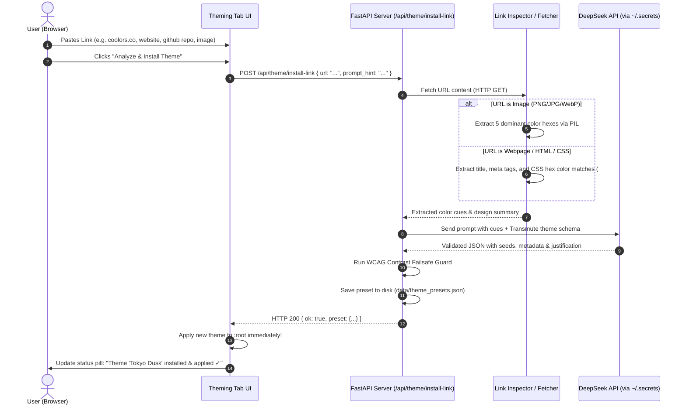

# Theming Tab & Dynamic Palette Extrapolation Spec

> **Status:** Draft / Proposed  
> **Audience:** Spec writers, builders, reviewers  
> **Target Module:** `docs/theming-tab-spec.md`  
> **Related:** `app/static/css/base.css`, `app/static/js/tabs/settings.js`, `app/agents/secrets.py`, `app/agents/http_api.py`, `STATUS.md`  
> **Version Scope:** Next minor release (`8.138+`)  

---

## 1. Overview & Objectives

The **Theming Tab** introduces a first-class, dynamic aesthetic control system to the Transmute WebUI. Rather than forcing users to hand-tune dozens of low-level CSS custom properties or editing raw stylesheets, the theming engine uses a **generative seed-color approach**: the user picks a small number of core seed colors (background, panel/surface, primary brand, secondary accent), and the system automatically extrapolates the entire suite of UI shades, borders, glow layers, input backgrounds, and WCAG-compliant contrast text/line colors.

Key functional capabilities:
1. **Basic Seed Color Mode**: Minimal, intuitive color selection with real-time mathematical extrapolation of all shades, elevations, borders, and contrast ratios.
2. **Accessible Contrast Calculation**: Built-in WCAG 2.1 relative luminance and contrast engine ensuring high readability (AA ≥ 4.5:1, AAA ≥ 7:1) across both dark and light modes.
3. **Preset Management**: Instant Save, Load, Export, Import, and Reset capabilities, shipping with curated factory presets (Cyberpunk, Tokyo Night, Nord, Dracula, High Contrast, etc.).
4. **AI Theme Installation via DeepSeek**: Direct ingestion of design references from any user-provided URL (palette sites, GitHub repos, external landing pages, wallpaper images). Uses the user's `DEEPSEEK_API_KEY` (from `~/.secrets`) to analyze the source material, extract the aesthetic intent, generate harmonious seed colors and token overrides, validate contrast, and install/apply the theme with one click.
5. **Granular Overrides (Roadmap / Advanced Mode)**: An expandable section exposing every single CSS custom property for power users who want micro-control over individual UI components.

---

## 2. Invariants & Architecture Compliance

| Invariant | Compliance Requirement in Theming Spec |
|:---|:---|
| **Invariant 2: Subprocesses** | Link fetching and DeepSeek API calls use standard asynchronous Python libraries (`urllib` / `httpx`). If external command utilities are invoked, they must strictly follow `shell.run_command` with argv lists. Never `shell=True`. |
| **Invariant 7: Vanilla Frontend** | Zero npm, React, Vue, or Tailwind. Pure vanilla HTML5, CSS3 Custom Properties, and ES6 modules (`js/tabs/theme.js`, `css/theme.css`). |
| **Invariant 10: HTTP Responses** | Server theme endpoints must return HTTP 200 with `{"ok": false, "error": "..."}` on errors (e.g. invalid URL, missing API key, network timeout), never uncaught 500s. |
| **Invariant 11: `main.py`** | No `from __future__ import annotations` in `main.py` when registering theme routes. |
| **Invariant 12: WebUI Proof** | Automated Playwright acceptance suite (`junk/theme-prove.mjs`) clicking real UI controls (color inputs, preset selector, save/load buttons, DeepSeek install button) with 0 console errors. |
| **House Rule: Help-Strip** | No native `title="..."` tooltips anywhere on the theme tab. Every interactive control must carry `data-help-title` and `data-help-text` feeding the bottom help bar. |
| **House Rule: FOUC Prevention** | Theme application must be instantaneous and persistent. On initial page load, the active theme tokens must be applied to `:root` before first paint (via inline head boot script reading `mtapi.active_theme`), preventing flash-of-unstyled-content. |

---

## 3. Generative Color Engine (Seed Extrapolation)

### 3.1 Core Seed Inputs (Basic Mode)

In Basic Mode, the user defines only 4 seed colors:

| Seed Parameter | Token Target | Description | Example (Default Dark) |
|:---|:---|:---|:---|
| `seed_bg` | Canvas Base | Deepest backdrop and window canvas | `#080B11` |
| `seed_panel` | Surface Base | Base hue for cards, sidebars, modal surfaces | `#111827` |
| `seed_primary`| Brand / Action | Active states, primary buttons, knob arcs | `#3B82F6` |
| `seed_accent` | Highlight / Flair | Badges, secondary glow, gradient counterpoints | `#A855F7` |

### 3.2 Extrapolation Mathematics

From these 4 seed colors, the engine computes RGB, HSL, and relative luminance $L$ to extrapolate the full palette:

```
L = 0.2126 * R_lin + 0.7152 * G_lin + 0.0722 * B_lin
where C_lin = (C_srgb <= 0.04045) ? (C_srgb / 12.92) : ((C_srgb + 0.055) / 1.055) ^ 2.4
```

#### A. Surface & Elevation Steps
1. **`--bg-color`**: Directly assigned from `seed_bg`.
2. **`--bg-inset`**: Shift luminance by $-4\%$ (dark mode) or $+4\%$ (light mode), adjusting saturation slightly (+5%) for depth.
3. **`--panel-bg`**: Derived from `seed_panel` converted to RGBA with user-adjustable opacity (default `0.70`), paired with backdrop filter `--glass-blur`.
4. **`--input-bg`**: Calculated as a midpoint between `seed_bg` and `seed_panel` (e.g. `mix(seed_bg, seed_panel, 0.4)` in dark mode).
5. **`--input-bg-hover`**: Luminance step $+6\%$ from `--input-bg`.

#### B. Border & Line Contrast
1. **`--panel-border`**: Rather than a static white or black opacity, `--panel-border` is calculated dynamically against `seed_bg`:
   - Dark theme ($L_{\text{bg}} < 0.2$): `rgba(255, 255, 255, 0.08)` tinted with $10\%$ `seed_primary`.
   - Light theme ($L_{\text{bg}} \ge 0.2$): `rgba(0, 0, 0, 0.12)` tinted with $10\%$ `seed_panel`.
   - Contrast check: ensures borders have at least 1.5:1 edge distinction against both background and panel.

#### C. Brand, Hover & Glow Extrapolations
1. **`--primary`**: Directly assigned from `seed_primary`.
2. **`--primary-hover`**: Lightness $+12\%$ (dark mode) or $-10\%$ (light mode).
3. **`--primary-glow`**: `rgba(r, g, b, 0.35)` generated from `seed_primary`.
4. **`--accent`**: Directly assigned from `seed_accent`.
5. **`--accent-glow`**: `rgba(r, g, b, 0.35)` generated from `seed_accent`.
6. **`--accent-muted`**: `rgba(r, g, b, 0.15)` desaturated by $20\%$.

#### D. Semantic Status Colors
Defaults to calibrated high-visibility triplets, optionally tinted toward the primary hue:
- `--success`: `#10B981` (Glow: `rgba(16, 185, 129, 0.25)`)
- `--warning`: `#F59E0B` (Glow: `rgba(245, 158, 11, 0.25)`)
- `--error`: `#EF4444` (Glow: `rgba(239, 68, 68, 0.25)`)

### 3.3 Contrast & WCAG Compliance Engine

The engine calculates contrast ratio against background and surface:
$$\text{Contrast Ratio} = \frac{L_1 + 0.05}{L_2 + 0.05} \quad (\text{where } L_1 > L_2)$$

1. **Theme Mode Detection**:
   - If $L(\text{seed\_bg}) < 0.2 \implies \text{Dark Mode}$ (`color-scheme: dark`).
   - If $L(\text{seed\_bg}) \ge 0.2 \implies \text{Light Mode}$ (`color-scheme: light`).
2. **Text Calculation**:
   - **`--text-main`**:
     - Dark Mode: Near-white (e.g. `#F3F4F6` or tinted with $3\%$ primary) verified to achieve $\ge 7.0:1$ ratio against `--bg-color` and `--panel-bg`.
     - Light Mode: Near-black (e.g. `#111827` or slate `#0F172A`) verified to achieve $\ge 7.0:1$ ratio.
   - **`--text-muted`**:
     - Adjusted to guarantee $\ge 4.5:1$ ratio (WCAG AA normal text) against `--bg-color` and `--panel-bg`.
   - **`--text-dim`**:
     - Set to guarantee $\ge 3.0:1$ ratio (WCAG AA large text / non-essential icons).
3. **Button Label Contrast**:
   - When rendering text inside elements colored with `--primary`, the engine automatically selects dark text (`#0F172A`) or light text (`#FFFFFF`) based on whichever satisfies the highest contrast ratio against `--primary`.

### 3.4 Full Token Mapping

The generated dictionary maps 1:1 to the stylesheet custom properties:

```css
:root {
  /* Surface & Canvas */
  --bg-color: #080B11;
  --bg-inset: #05070A;
  --panel-bg: rgba(17, 24, 39, 0.70);
  --panel-border: rgba(255, 255, 255, 0.08);
  --input-bg: #111827;
  --input-bg-hover: #1F2937;

  /* Brand & Accents */
  --primary: #3B82F6;
  --primary-hover: #60A5FA;
  --primary-glow: rgba(59, 130, 246, 0.35);
  --accent: #A855F7;
  --accent-glow: rgba(168, 85, 247, 0.35);
  --accent-muted: rgba(168, 85, 247, 0.15);

  /* Status */
  --success: #10B981;
  --warning: #F59E0B;
  --error: #EF4444;

  /* Typography & Lines */
  --text-main: #F3F4F6;
  --text-muted: #9CA3AF;
  --text-dim: #6B7280;

  /* FX & Geometry */
  --glass-blur: 16px;
  --radius-lg: 16px;
  --radius-md: 10px;
  --radius-sm: 6px;
}
```

### 3.5 Advanced / Granular Overrides (Roadmap)

To fulfill the user's vision (*"eventually i want to make it so we can define every single thing if we'd like but for now just the basics"*):
- The UI contains a collapsible card: **"Advanced Token Overrides"**.
- Displays an expandable grid of color pickers for every single CSS property above.
- Each property displays a badge: `Auto (Extrapolated)` or `Manual (Overridden)`.
- Includes a per-property "Reset to Auto" action and a global "Reset All Overrides" button.
- In v1, this UI is collapsed by default to keep the interface clean and approachable.

---

## 4. Preset Management System

### 4.1 Preset Schema (`mtapi-theme-preset/1`)

```json
{
  "$schema": "mtapi-theme-preset/1",
  "id": "tokyo-night",
  "name": "Tokyo Night",
  "author": "System",
  "description": "Deep navy city nights with vibrant violet and cyan accents",
  "created_at": "2026-10-07T14:00:00Z",
  "is_dark": true,
  "seeds": {
    "bg": "#1A1B26",
    "panel": "#24283B",
    "primary": "#7AA2F7",
    "accent": "#BB9AF7"
  },
  "tuning": {
    "glass_blur_px": 16,
    "panel_opacity": 0.75,
    "contrast_boost": 1.0,
    "border_tint": true
  },
  "overrides": {}
}
```

### 4.2 Factory Bundled Presets

The following presets ship out-of-the-box in `app/static/data/theme_presets.json`:
1. **Transmute Classic (Default)**: Deep slate black (`#080B11`), dark blue panel (`#111827`), royal blue (`#3B82F6`), purple accent (`#A855F7`).
2. **Cyberpunk 2077**: Midnight black (`#0D0D11`), neon yellow primary (`#FCEE0A`), cyan accent (`#00F0FF`), magenta highlights.
3. **Tokyo Night**: Deep indigo (`#1A1B26`), storm blue panel (`#24283B`), pastel blue (`#7AA2F7`), soft purple (`#BB9AF7`).
4. **Nord**: Polar night (`#2E3440`), snow storm panel (`#3B4252`), frost cyan (`#88C0D0`), aurora green (`#A3BE8C`).
5. **Dracula**: Vampire darkness (`#282A36`), selection panel (`#44475A`), purple (`#BD93F9`), pink accent (`#FF79C6`).
6. **Solarized Dark**: Dark teal (`#002B36`), base panel (`#073642`), blue (`#268BD2`), magenta (`#D33682`).
7. **High Contrast AAA**: Pure black (`#000000`), deep charcoal panel (`#141414`), intense electric blue (`#2F81F7`), pure white text (`#FFFFFF`) — tuned for maximum legibility.

### 4.3 Preset Lifecycle Actions

- **Apply Preset**: Loads preset configuration, recomputes extrapolated tokens, updates `:root` CSS variables immediately, and persists active ID to `localStorage['mtapi.active_theme']`.
- **Save Current as Preset**: Prompts user for a Name and Description; validates uniqueness; writes to client `localStorage['mtapi.user_theme_presets']` and synchronizes to server storage (`POST /api/theme/presets`).
- **Export Preset**: Downloads a `.theme.json` file.
- **Import Preset**: File picker accepts `.theme.json`, validates schema, adds to preset list, and prompts to activate.
- **Reset to Default**: Reverts all settings to Transmute Classic.

---

## 5. DeepSeek AI Theme Generation & Installation from Link

### 5.1 Architecture & Credentials

The user can paste any link into the **"Install Theme from Link"** box.
The server calls the DeepSeek API using the user's existing secret configuration:
- Reads `DEEPSEEK_API_KEY` from `~/.secrets` using the repository's established `app.agents.secrets.get_secret()` helper.
- Uses the official DeepSeek endpoint: `https://api.deepseek.com/v1/chat/completions`.
- Model: `deepseek-chat` (configured in `app/agents/http_api.py`).

### 5.2 Link Ingestion & Analysis Flow



### 5.3 DeepSeek Prompt Specification

The prompt is crafted to enforce strict JSON output with balanced UI seeds and WCAG compliance:

```text
You are an expert design systems engineer and color theorist.
Your task is to generate a complete visual theme for the Transmute WebUI desktop media application based on the provided reference material.

The reference link provided is: {url}
Reference analysis summary:
- Extracted palette cues / dominant colors: {color_cues}
- Page context: {page_context}
- User hint: {user_hint}

Theme Requirements:
1. Seed Colors:
   - "bg": Canvas background. Dark mode is preferred unless the user explicitly requested light. Must have low luminance (typically < 0.15) for deep dark themes.
   - "panel": Surface color for cards and modals. Must be slightly lighter than "bg".
   - "primary": Vibrant, distinctive brand/accent color for buttons, active tabs, and sliders.
   - "accent": Harmonious secondary color for badges and decorative glows.
2. Contrast Safety:
   - Text colors will be extrapolated automatically. Ensure your primary and accent colors maintain high contrast against both bg and panel surfaces.
3. Return strictly valid JSON with this exact schema:
{
  "name": "Creative Theme Name",
  "description": "Short explanation of the vibe and color inspiration",
  "is_dark": true,
  "seeds": {
    "bg": "#RRGGBB",
    "panel": "#RRGGBB",
    "primary": "#RRGGBB",
    "accent": "#RRGGBB"
  },
  "tuning": {
    "glass_blur_px": 16,
    "panel_opacity": 0.75,
    "contrast_boost": 1.0
  }
}
Do not include any conversational preamble or markdown code fence blocks. Output JSON only.
```

### 5.4 Backend Verification & Contrast Failsafe Guard

Before saving and returning the DeepSeek-generated preset:
1. **Schema Check**: Verifies valid hex formats (`^#[0-9a-fA-F]{6}$`).
2. **Contrast Guard**: Computes relative luminance of `seeds.bg` and `seeds.panel`.
   - If $L(\text{bg}) \ge 0.2$ and `is_dark: true`, clamps `seeds.bg` luminance down or corrects `is_dark: false`.
   - Checks contrast of `seeds.primary` against `seeds.bg`. If contrast is $< 3.0:1$, slightly shifts lightness to ensure button visibility.
3. **Sanitization**: Names and descriptions are HTML-escaped.

---

## 6. WebUI Interface Design (`Theme` Tab)

### 6.1 Placement & Navigation

- **Sidebar Section**: Located under `Workspace` (or `Settings`), with nav ID `data-tab="theme"`.
- **Nav Header / Item**:
  ```html
  <div class="nav-item" data-tab="theme" data-help-title="Theming" data-help-text="Customize WebUI colors, extrapolate contrast-safe shades, manage presets, or install themes from links using DeepSeek.">
    <svg viewBox="0 0 24 24" fill="none" stroke="currentColor" stroke-width="2" stroke-linecap="round" stroke-linejoin="round">
      <circle cx="13.5" cy="6.5" r=".5" fill="currentColor"/>
      <circle cx="17.5" cy="10.5" r=".5" fill="currentColor"/>
      <circle cx="8.5" cy="7.5" r=".5" fill="currentColor"/>
      <circle cx="6.5" cy="12.5" r=".5" fill="currentColor"/>
      <path d="M12 2C6.49 2 2 6.49 2 12c0 3.31 2.69 6 6 6h1.5c.83 0 1.5.67 1.5 1.5 0 .83.67 1.5 1.5 1.5H14c4.42 0 8-3.58 8-8 0-6.08-4.92-11-10-11z"/>
    </svg>
    Theme
  </div>
  ```

### 6.2 Tab Layout & Cards

The tab uses the standard `.action-panel-content` container with 4 cards:

1. **Card 1: Presets & Quick Select**:
   - Preset Dropdown (`#themePresetSelect`) with factory and user presets.
   - Action Buttons: `Save Current`, `Export JSON`, `Import JSON`, `Reset Default`.
   - Live Status Pill: Displays current active theme name and author.
2. **Card 2: Basic Seed Colors (Extrapolated)**:
   - 4 Seed Color Pickers:
     - Background Color (`#seedBgColor` + synced hex text input)
     - Panel Surface (`#seedPanelColor` + synced hex text input)
     - Primary Brand (`#seedPrimaryColor` + synced hex text input)
     - Secondary Accent (`#seedAccentColor` + synced hex text input)
   - Real-time Extrapolation Preview Bar:
     - Swatches displaying derived `--bg-inset`, `--input-bg`, `--primary-hover`, `--panel-border`, `--text-main`, `--text-muted`.
     - Contrast Score Badges: Displays measured WCAG contrast ratio (e.g. `AAA 12.4:1` on background, `AA 5.2:1` on primary).
   - Sliders:
     - Glass Blur (`0px` to `32px`)
     - Panel Opacity (`0.4` to `1.0`)
3. **Card 3: Install from Link (DeepSeek AI)**:
   - URL Input (`#themeLinkInput`): Placeholder `"https://coolors.co/... or any website / image link"`.
   - Style Hint Input (`#themePromptHint`): Optional prompt (e.g. `"make it moody and neon"`).
   - Action Button (`#btnThemeInstallLink`): `"✦ Analyze & Install with DeepSeek"`.
   - DeepSeek Status Pill: Reports progress (`Fetching link...` $\to$ `Calling DeepSeek...` $\to$ `Theme Installed ✓`).
4. **Card 4: Advanced Token Overrides (Collapsible)**:
   - Header: `"Advanced Token Overrides (Optional)"` with collapse chevron.
   - Expandable table of individual CSS variables with manual override inputs and reset buttons.

### 6.3 Immediate Live Reactivity

Every change to a color picker or preset dropdown executes:
```javascript
function applyThemeTokens(tokens) {
  const root = document.documentElement;
  for (const [key, value] of Object.entries(tokens)) {
    root.style.setProperty(key, value);
  }
  // chromium scrollbar repaint helper
  applyUiTweaks();
}
```
There is zero page reload, zero latency, and zero flash. The entire WebUI updates in real time on every input stroke.

---

## 7. Server API Endpoints

All endpoints are hosted in `app/routes/theme.py` and registered in `app/main.py`:

| Method | Endpoint | Description | Payload / Response |
|:---|:---|:---|:---|
| `GET` | `/api/theme/presets` | List all available presets (bundled + user) | Returns `{"ok": true, "presets": [...]}` |
| `POST` | `/api/theme/presets` | Save or update a user preset | Body: `{ preset: {...} }` $\to$ `{"ok": true, "id": "..."}` |
| `DELETE` | `/api/theme/presets/{id}` | Delete a user-saved preset | Returns `{"ok": true}` |
| `POST` | `/api/theme/install-link` | Fetch link, run DeepSeek, generate & install preset | Body: `{ "url": "...", "hint": "..." }` $\to$ `{"ok": true, "preset": {...}}` |

---

## 8. Verification Strategy & Acceptance Tests

1. **Fast Gate Verification**:
   - `./check-gate.sh` must remain 5/5 green.
2. **PyTest Suite** (`tests/test_theme_routes.py`):
   - Test preset listing, saving, updating, and deleting.
   - Test mathematical extrapolation helper (RGB $\to$ luminance $\to$ WCAG contrast ratio $\to$ correct dark/light classification).
   - Test DeepSeek prompt builder and response parser with mocked API returns.
   - Test error handling when URL is invalid or `DEEPSEEK_API_KEY` is missing (must return HTTP 200 with `{"ok": false, ...}` per Invariant 10).
3. **Playwright E2E UI Suite** (`junk/theme-prove.mjs`):
   - Navigate to `#nav-item[data-tab="theme"]`.
   - Verify all 4 seed color inputs and sliders render with help-strip attributes.
   - Change `seedPrimaryColor` to `#10B981` (emerald green) and assert `document.documentElement` receives updated `--primary` and `--primary-glow`.
   - Select "Tokyo Night" from presets dropdown and assert `--bg-color` updates to `#1A1B26`.
   - Save custom preset, refresh page, and verify active theme persisted without FOUC.
   - Trigger DeepSeek install flow with test fixture link and verify theme applies and status pill updates.
   - Verify 0 console errors throughout.
